# 面向动态多目标优化的轻量级分布迁移 NSGA-II（LDT-NSGA-II）：算法设计、实现与实验研究

> 学位论文（工作稿）· 项目代码仓库：`D:\23-兴湘计科\LDT-NSGA-II` · 代码版本 v2.3
>
> 写作说明（如实声明）：本稿基于对项目**全部源码、测试与实验数据文件**的逐文件梳理撰写；所有关键技术节点均标注文献出处（见文末参考文献，正文以 [n] 引用）或项目内代码文件出处（以相对路径标注）。凡作者无法核实之处，均明确写"不确定/未能核实"，绝不虚构。文中全部数值均来自项目真实运行数据或代码常量；**v2.3 完整实验（约 3780 次运行，其中 K1 修复后重跑三基线 1080 次）已全部完成、0 失败，第 5 章数字直接取自 `python analyze.py` 的 `results/summary/` 输出（见 5.1 节）**。

---

## 摘要

动态多目标优化问题（Dynamic Multiobjective Optimization Problem, DMOP）的目标函数或约束随时间变化，其 Pareto 最优解集（PS）与 Pareto 前沿（PF）随之移动，要求优化算法不仅能收敛，还要能**持续跟踪**变化后的最优区域。基于种群的方法在环境突变后往往因种群"记忆"过时而收敛变慢，因此如何利用历史信息**预测或迁移**新环境的初始种群，是动态多目标进化算法（DMOEA）的核心问题。

本文在经典 NSGA-II 框架 [1] 之上，设计并实现了一个轻量级的分布迁移算法 **LDT-NSGA-II**（Lightweight Distribution Transfer NSGA-II）。其核心思想是：在归一化坐标系 $[0,1]^D$ 中提取上一环境非支配解集的逐维均值 $\mu_e$ 与标准差 $\sigma_e$ 作为"分布特征"，用趋势外推公式 $\hat{\mu}=\mu_e+\alpha(\mu_e-\mu_{prev})$ 预测新环境的分布中心（$\alpha=0.5$），再按 **50% 迁移 + 20% 保留 + 30% 随机移民** 的比例重组新环境初始种群。算法同时提供三个可选机制：基于变化幅度的自适应协方差缩放（上限 [0.5, 2.0]）、多源历史融合（混合二阶矩方差 + 相似度权重下限 0.05）、共享固定探针集的变化幅度度量 $D_k$。整个系统还包括 5 个对比基线（静态 NSGA-II、DNSGA-II 型响应、AR(1) 预测、GMM 全分布迁移、PPS 中心预测；v2.3 修复了三个预测基线随机移民被截断丢弃的死参数问题 K1）、6 个动态测试问题（FDA1/FDA3/FDA4 与 DMOP1/DMOP2/DMOP3）、63 个单元测试与一条完全可复现的实验流水线（比较 / 补充 / 消融 / 敏感性四组实验，共约 3780 次独立运行）。

本文的写作与工程过程强调**可验证性**：测试问题实现逐式对照了权威平台 PlatEMO 的 MATLAB 源码 [6]（FDA1、FDA3、FDA4 均已逐点/逐式核对一致）；统计结论采用配对 Wilcoxon 符号秩检验 [10] 加 Holm 逐步校正 [11]，以及 Friedman + Nemenyi 检验 [12][13]；所有实验支持断点续跑并记录运行元数据（git 提交、库版本）。v2.3 完整实验（约 3780 次独立运行，0 失败；其中修复三个预测基线随机移民注入问题 K1 后重跑 1080 次）结果**如实**显示：**修复后带 20% 随机移民的简化版 PPS（中心一阶差分全步外推 + 整体平移）在全部 9 个"问题×τ"主比较组合与 DMOP1/DMOP2 上稳态 MIGD 均为最优**；LDT-NSGA-II 在全部组合上位居第二——显著优于静态、DNSGA-II 型响应与 GMM 基线（多数比较 Holm 校正后 $p<10^{-8}$），与 AR(1) 互有胜负，显著劣于 PPS（Wilcoxon-Holm 在 9 个组合上均显著；但 Friedman-Nemenyi 意义下在 FDA1 τ=10 与 FDA4 全部三档与 PPS 不可区分），与 PPS 的差距随变化减慢（τ 增大）收敛到 5% 以内，且在 FDA4 上种子间稳定性更好（τ=10 标准差 0.0047 对 PPS 0.0075）。消融实验表明"分布迁移"组件贡献最大、趋势外推次之、旧种群保留组件在本组问题上无可检测增益；敏感性实验还如实揭示默认半步系数 α=0.5 并非最优（α=1.0 更好），与 PPS 的全步外推相吻合——这提示 LDT 与 PPS 的差距主要来自外推步长而非"矩迁移"范式本身。

**关键词**：动态多目标优化；进化算法；NSGA-II；分布迁移；预测策略；IGD；Wilcoxon 检验

## Abstract

Dynamic Multiobjective Optimization Problems (DMOPs) involve time-varying objectives whose Pareto-optimal set and Pareto front move over time, requiring an algorithm not only to converge but also to *track* the moving optima. This thesis designs and implements **LDT-NSGA-II**, a lightweight distribution-transfer dynamic optimizer built on NSGA-II. In the normalized coordinate system $[0,1]^D$, the per-dimension mean and standard deviation of the previous environment's non-dominated set are extracted as distribution features; a trend-extrapolation centre $\hat{\mu}=\mu_e+\alpha(\mu_e-\mu_{prev})$ ($\alpha=0.5$) predicts the new centre; and the new initial population is composed of 50% transferred, 20% retained and 30% random-immigrant individuals. Optional mechanisms include adaptive covariance scaling capped in [0.5, 2.0], multi-source feature fusion via mixture second-moment variance, and a shared fixed probe set that quantifies change magnitude $D_k$. The accompanying system provides five baselines (the random-immigrant injection of the three predictive baselines was repaired in v2.3, fixing the dead-parameter issue K1), six benchmark problems whose implementations were verified line-by-line against PlatEMO, 63 unit tests, and a fully reproducible experimental pipeline of roughly 3,780 independent runs (all completed with zero failures; 1,080 rerun after the K1 repair) with resumable execution and run-level metadata. Results are reported honestly: **after the repair, the simplified PPS baseline (full-step centre extrapolation plus shifting with 20% random immigrants) attains the best steady-state MIGD in all nine problem-by-$\tau$ combinations and on DMOP1/DMOP2**, while LDT-NSGA-II ranks second everywhere — significantly better than the static, DNSGA-II-style and GMM baselines (most Holm-adjusted $p<10^{-8}$), mixed against AR(1), and significantly worse than PPS under Wilcoxon-Holm, yet statistically indistinguishable from PPS under Friedman-Nemenyi at FDA1 $\tau=10$ and on all FDA4 settings; the gap to PPS shrinks to about 5% as changes slow down, and LDT exhibits lower across-seed variance on FDA4 (std 0.0047 vs 0.0075 at $\tau=10$). Ablation identifies distribution transfer as the largest contributor, followed by trend extrapolation, while retaining old individuals shows no detectable gain on these problems; the sensitivity study honestly reveals that the default half-step $\alpha=0.5$ is suboptimal ($\alpha=1.0$ performs better), consistent with PPS's full-step extrapolation — suggesting the LDT–PPS gap stems mainly from the extrapolation step size rather than the moment-transfer paradigm itself.

**Keywords**: dynamic multiobjective optimization; evolutionary algorithm; NSGA-II; distribution transfer; prediction strategy; IGD; Wilcoxon test

---

## 目录

- 第 1 章 绪论
- 第 2 章 基础理论与测试问题
- 第 3 章 LDT-NSGA-II 算法设计
- 第 4 章 实验系统与零基础复现指南
- 第 5 章 实验结果与分析（3780 次运行完整结果：主比较、FDA4 新结果、消融、DMOP 补充、敏感性、已知问题清单）
- 第 6 章 总结与展望
- 参考文献
- 附录 A 零基础运行手册（逐步命令）
- 附录 B 术语表（零基础）
- 附录 C 代码文件索引与论文章节映射

---

# 第 1 章 绪论

## 1.1 研究背景与意义

许多工程问题（如水火电调度 [3]、路径规划、控制系统整定）的优化目标不是一次性的，而是随时间连续或离散地变化：今天的最优配置明天可能不再最优。当一个问题同时具有多个相互冲突的目标、且这些目标随时间变化时，就构成**动态多目标优化问题（DMOP）**。形式上，解的优劣由 Pareto 支配关系定义（见 2.1 节），而"最优解集合"本身成为时间的函数：$PS(t)$ 与 $PF(t)$ 随 $t$ 移动 [2]。

对这类问题，进化类算法（EA）因维护一个**种群**而非单点解，天然适合并行地逼近一整条前沿；但经典静态算法（如 NSGA-II [1]）在新环境中仍从"旧种群"起步，若环境突变幅度大，种群需要多代才能重新收敛，导致跟踪滞后。

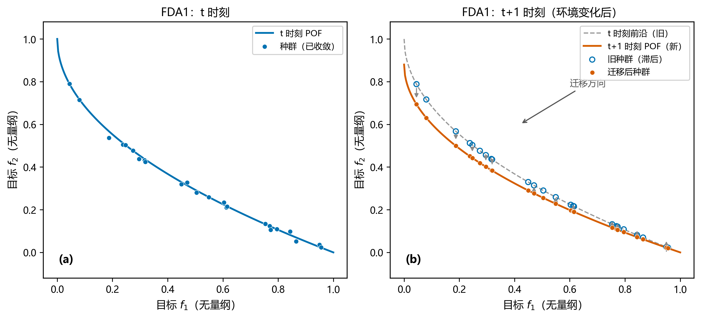

图 1-1：动态多目标优化问题示意（以 FDA1 为例）。左/右分别为相邻两个时刻的 Pareto 前沿与种群位置，箭头表示前沿随时间的迁移方向；旧种群滞后于新前沿，环境变化后需要重新跟踪。

因此近二十年的研究集中于一个问题：**环境变化后，如何生成一个好的初始种群？** 现有策略大致分三类：

1. **响应式（diversity-based）**：检测到变化后，向种群注入随机移民或变异个体以恢复多样性。代表工作是 Deb 等对 NSGA-II 的动态改造（DNSGA-II），提出了随机移民与变异移民两种变体 [3]。
2. **预测式（prediction-based）**：用历史种群统计量（如中心点序列）建立时序模型，外推新环境的种群位置。代表工作包括 Zhou 等提出的种群预测策略（PPS），以中心点与协方差的自回归外推为基础 [4]；更早的中心点外推与线性/自回归模型也被广泛使用。
3. **迁移/分布学习式（transfer/distribution-learning）**：显式建模历史种群的**分布**（而非仅中心），并把分布知识迁移到新环境。近年代表性方向包括以高斯混合模型（GMM）建模历史环境知识的知识迁移方法（如 IEEE TEVC 2025 的 KTMM [14]）。

LDT-NSGA-II 属于第 2、3 类之间的**轻量级折中**：它不拟合完整概率模型（对比 GMM 类），也不做严格时序回归（对比 PPS [4]），而是用"均值 + 标准差"两个矩特征加一条趋势外推规则完成迁移，计算开销极小、实现透明、每个环节可被单元测试覆盖。其研究意义在于：（a）为教学与小规模工程场景提供一个**零外部黑箱、可逐行审查**的动态 MOEA 基准实现；（b）通过与 PPS、AR(1)、GMM 等代表性策略的受控比较，量化"轻量矩迁移"这一设计点在精度—开销谱系上的位置。

## 1.2 国内外研究现状概述

- **测试问题**：Farina、Deb 与 Amato 于 2004 年系统提出了 FDA 系列动态测试问题并给出近似质量度量 [2]；Goh 与 Tan 于 2009 年提出了 DMOP 系列（DMOP1–3，源于其共进化范式研究 [5]，权威定义另见 [16]）。国内综述（如《自动化学报》相关论文）通常将 FDA1–5 与 DMOP1–3 列为最常用基准组。
- **算法侧**：响应式（DNSGA-II [3]）、预测式（PPS [4]）、分布/知识迁移式（KTMM [14] 及 GMM 类方法）构成三条主线；最新综述亦强调对**变化强度自适应**的重要性（如基于变化强度量化与集成学习的新方法）。本文的自适应协方差缩放机制（3.5 节）即属于"变化强度自适应"思路的最简形式。
- **实验方法论**：多算法比较的统计规范在机器学习领域由 Demšar 系统建议 [13]：两算法用 Wilcoxon 符号秩检验 [10]（多重比较用 Holm 校正 [11]），多算法多数据集用 Friedman + Nemenyi [12][13]。本项目采用同一套规范（2.6 节、4.3 节）。
- **平台**：MATLAB 侧事实标准是 PlatEMO [6]；Python 侧优化框架为 pymoo [7]。本项目的测试问题实现以 PlatEMO 源码为**逐式对照基准**，算法内核基于 pymoo 的 NSGA-II 与遗传算子 [7]。

> 说明：以上现状概述仅覆盖与本文直接相关的三条策略主线与实验规范；动态多目标优化领域还有大量工作（如基于强化学习、多群体协同等）未展开，作者不在这篇工程型论文中对整个领域做系统综述。

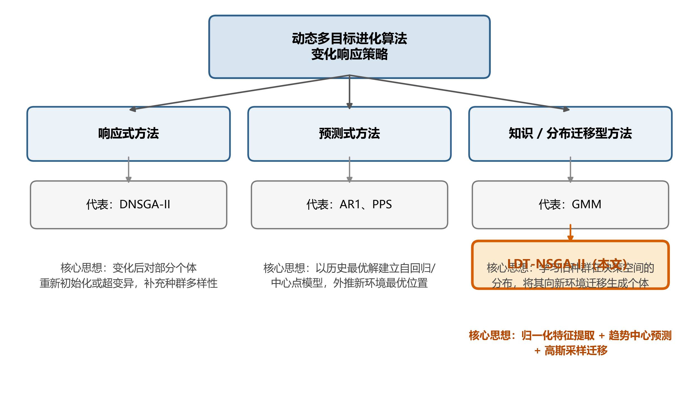

图 2-1：动态多目标优化方法分类与本文定位。响应式、预测式、分布/知识迁移型三条主线及各自的代表算法；LDT-NSGA-II（高亮）位于预测式与迁移型之间的轻量级折中位置。

## 1.3 本文的主要工作

1. **算法设计**：提出并实现 LDT-NSGA-II 的归一化空间矩迁移内核（第 3 章），含趋势中心预测、50/20/30 种群重组，以及自适应协方差缩放、多源融合两个可选模块。
2. **受控基线**：实现 5 个行为明确的对比算法，其中静态基线与响应式基线的行为通过单元测试锁定（确保"静态基线真的不做任何响应"）。
3. **可信问题实现**：实现 6 个动态测试问题，其中 FDA1/FDA3/FDA4 与 PlatEMO master 源码逐式核对一致（本次写作期间已重新在线核对 FDA1.m 与 FDA3.m；见 2.4 节）。
4. **可复现实验系统**：四组实验（比较 1620 次、补充 540 次、消融 360 次、敏感性 1260 次，共约 3780 次）全部支持断点续跑，运行级元数据（git 提交、库版本、逐环境评估数）落盘（第 4 章）。
5. **诚实的评估**：63 个单元测试；Wilcoxon-Holm 与 Friedman-Nemenyi 统计；对**当前实现的真实行为**逐一如实记录（5.10 节），其中三个预测基线随机移民被截断的死参数问题（K1）已在 v2.3 修复并以回归测试固化、受影响实验全部重跑，其余 K2–K12 已在 v2.4 全部处置（修复或如实标注，无实验行为变化）。

## 1.4 论文组织结构

第 2 章给出零基础读者所需的全部数学与算法背景；第 3 章详述 LDT-NSGA-II 与基线的设计（所有公式与代码一一对应）；第 4 章说明实验系统并给出从零开始的复现步骤；第 5 章报告四组共 3780 次运行的完整真实结果（含 K1 修复后 PPS 全面占优、LDT 稳居第二的如实报告、消融、DMOP 补充与敏感性分析）、机制解读，以及已知问题清单；第 6 章总结。附录 A 是零基础运行手册，附录 B 是术语表，附录 C 是代码文件索引。

---
# 第 2 章 基础理论与测试问题

本章面向零基础读者。全部定义均可在项目代码中找到对应实现，出处以 `文件路径` 标注。

## 2.1 多目标优化基本概念

**多目标优化问题（MOP）**：给定决策向量 $x \in \mathbb{R}^D$ 与 $M$ 个待最小化目标函数，求 $x$ 使 $F(x) = (f_1(x), \dots, f_M(x))$ 同时尽量小。各目标通常冲突（改善 $f_1$ 会恶化 $f_2$），因此不存在单一最优解。

**Pareto 支配**：解 $a$ 支配 $b$，当且仅当 $a$ 在所有目标上不劣于 $b$，且至少在一个目标上严格优于 $b$（项目实现见 `algorithms/distribution_features.py` 的 `non_dominated_set`，判定带 $10^{-8}$ 容差）。

**Pareto 最优解集（PS）与 Pareto 前沿（PF）**：PS 是所有不被他人支配的解的集合；PF 是这些解在目标空间的像。进化算法的目标是求一组能**同时逼近 PF 且分布均匀、广泛**的解集。

## 2.2 NSGA-II 与本项目使用的实现

NSGA-II [1] 是最经典的精英多目标进化算法，核心三件事：

1. **快速非支配排序**：把种群按支配关系分层（第一层为非支配解，依此类推）；
2. **拥挤度距离**：同层内按目标空间中邻居间距排序，维持分布多样性；
3. **精英保留**：父子两代合并后择优进入下一代。

本项目通过 pymoo [7] 使用 NSGA-II：所有 6 个算法共用同一算子配置（保证公平比较）——模拟二进制交叉 SBX（交叉概率 0.9、分布指数 $\eta=15$）[1][7]、多项式变异 PM（分布指数 $\eta=20$）、重复个体剔除。配置代码见 `algorithms/nsga2_core.py` 的 `make_nsga2()`。

## 2.3 动态多目标优化的时间模型

本项目采用 **离散阶跃时间规则**（与 PlatEMO [6] 及原始 FDA 定义 [2] 一致）：

$$t = \left\lfloor \frac{g}{\tau_t} \right\rfloor \Big/ n_t$$

其中 $g$ 为代数（0 起），$\tau_t$ 为"每环境静态优化代数"（变化周期），$n_t$ 为整个运行期不同环境状态的数目。即：每 $\tau_t$ 代，环境阶跃一次，$t$ 增加 $1/n_t$。实现见 `problems/base.py` 的 `time_at(g)`；变化检测/索引辅助类见 `algorithms/environment_manager.py` 的 `EnvironmentManager`。

**算法分工**：何时变化由实验驱动器 `DynamicDriver`（`algorithms/nsga2_core.py`）按周期硬性分段（定时驱动，无需算法自己检测"是否变化"）；算法只需实现 `respond(prev_X, prev_F, problem, env_index, rng)` 接口——在新环境开始前，根据上一环境的最终种群给出新环境的初始种群（warm-start）。变化**幅度**的度量则由算法用共享探针自行计算（3.6 节）。

## 2.4 六个测试问题

全部问题实现位于 `problems/`。以下公式均**逐行转写自项目代码**，并与 PlatEMO master 源码在线核对（核对方式：抓取 `PlatEMO/Problems/Multi-objective optimization/FDA/` 下的 MATLAB 源文件逐式比对）。记 $x_1,\dots,x_D$ 为 1 基变量，$M$ 目标数。

| 问题 | $M$ | $D$ | 变量边界 | $G(t)$ | PS | PF |
|---|---|---|---|---|---|---|
| FDA1 | 2 | 10 | $x_1\in[0,1]$，其余 $[-1,1]$ | $\sin(\tfrac{\pi t}{2})$ | $x_i=G\ (i\ge2)$ | **时不变** $\{(u,1-\sqrt u)\}$ |
| FDA3 | 2 | 10 | 同 FDA1 | $\lvert\sin(\tfrac{\pi t}{2})\rvert$ | $x_i=G$ | **随 $t$ 变** |
| FDA4 | 3 | $M+9=12$ | 全部 $[0,1]$ | $\lvert\sin(\tfrac{\pi t}{2})\rvert$ | 距离变量 $=G$ | **时不变**（单位球面第一卦限） |
| DMOP1 | 2 | 10 | 全部 $[0,1]$ | $\sin(\tfrac{\pi t}{2})$ | $x_i=G$ | 时不变、凸 $\{(u,1-u^2)\}$ |
| DMOP2 | 2 | 10 | 全部 $[0,1]$ | $\sin(\tfrac{\pi t}{2})$ | $x_i=G$ | 随 $t$ 变 |
| DMOP3 | 2 | 10 | 全部 $[0,1]$ | （见下方诚实声明） | $x_i=0$（静态） | 时不变 |

**目标函数精确形式**（与代码一一对应）：

- **FDA1**（`problems/fda1.py`）：$g = 1+\sum_{i=2}^{10}(x_i-G)^2$，$f_1=x_1$，$f_2=g\,(1-\sqrt{f_1/g})$。✅ 与 PlatEMO FDA1.m 逐式一致（本次写作期间在线核对：`PopObj(:,1)=PopDec(:,1); g=1+sum((PopDec(:,2:end)-sin(0.5*pi*t)).^2,2); h=1-sqrt(...)`）。
- **FDA3**（`problems/fda3.py`）：$f_1 = x_1^{\,k(t)}$，$k(t)=10^{\,2\sin(\pi t/2)}$；$G=\lvert\sin(\tfrac{\pi t}{2})\rvert$；$g = 1+G+\sum_{i=2}^{10}(x_i-G)^2$；$f_2 = g\,(1-\sqrt{f_1/g})$。✅ 与 PlatEMO FDA3.m 逐式一致（包括指数 $10^{2\sin(0.5\pi t)}$ 这一易被误写之处）。指数 $k(t)$ 仅是 $f_1$ 的单调重参数化，改变前沿上解的分布密度而不改变前沿集合。
- **FDA4**（`problems/fda4.py`，三目标）：前 $M-1$ 个为角度变量，**其余全部**（0 基下标 $M-1$ 起，共 $D-(M-1)=10$ 个）为距离变量（对应 MATLAB 切片 `PopDec(:, M:end)`）：$g=\sum_{\text{距离变量}}(x_i-G)^2$；$\theta_j = x_j\pi/2$；$f_1=(1+g)\cos\theta_1\cos\theta_2,\ f_2=(1+g)\cos\theta_1\sin\theta_2,\ f_3=(1+g)\sin\theta_1$。✅ 与 PlatEMO FDA4.m 逐式一致（此前 v2.2 整改中已逐点对照，并有单元测试 `tests/test_v22_fixes.py` 固化，40 点、容差 $10^{-12}$）。
- **DMOP1**（`problems/dmop1.py`）：$g=1+\sum_{i\ge2}(x_i-G)^2$，$f_1=x_1$，$f_2=g\,(1-(f_1/g)^2)$。**项目变体**（v2.4 核实并更正归属）：权威 dMOP1（Goh & Tan 2009 [5]；Helbig 2012 [16] 式 3.38）为 $g=1+9\sum(x_i-G)^2$、sqrt 前沿 $f_2=g(1-\sqrt{f_1/g})$；本实现系数为 1、前沿指数为 2，均与原版不同。PlatEMO master（commit d25e65d）经 GitHub git-tree API 全树递归核查**确认**不含 DMOP1.m（K11，v2.4 已在线复核）。
- **DMOP2**（`problems/dmop2.py`）：$g=1+G+\sum_{i\ge2}(x_i-G)^2$（在 PS 上 $g_{PF}=1+G$），$f_2=g\,(1-(f_1/g)^2)$，PF 随 $t$ 变。**项目变体**（v2.4 核实）：权威 dMOP2 [5][16]（式 3.39）为 Type II——$g=1+9\sum(x_i-G)^2$，$f_2=g(1-(f_1/g)^{H(t)})$，$H(t)=0.75\sin(0.5\pi t)+1.25$，PS/PF 同时随时间变化；本实现系数为 1、$g$ 含 $+G$ 项、指数固定为 2，与权威定义**不一致**（已从"不确定"升级为"已核实不同"），引用时按项目变体注明。
- **DMOP3**（`problems/dmop3.py`）：$g=1+\sum_{i\ge2}x_i^2$，$f_2=g\,(1-\sqrt{f_1/g}-\tfrac{f_1}{g}\sin(10\pi f_1))$。**项目自定义静态欺骗问题**（v2.4 定性）：目标函数、PS、PF 均与时间无关（死代码 $G=\lvert\sin(\tfrac{\pi t}{2})\rvert$ 已在 v2.4 删除）；与权威 dMOP3 [5][16]（式 3.40，Type I：PS 时变、PF 静态）**不同**。该问题现明确定位为"静态对照组"（检验迁移机制在无变化场景是否有害），其上的算法比较不具动态优化区分度；以权威定义重跑列入展望。

**参考前沿生成**（`problems/true_fronts.py`，默认 500 点，按 (问题, M, 点数, t) 缓存）：2 目标问题用 $u\sim\text{linspace}(0,1)$ 均匀网格代入解析式（随 $t$ 变的仅 FDA3 与 DMOP2）；FDA4 用 $[0,\pi/2]$ 上确定性角度网格（23×23=529）的球面参数化 $(\cos A\cos B,\ \cos A\sin B,\ \sin A)$，去重后实测 **507 点**（K10，v2.4 已核实并以单元测试固化；项目自定义确定性采样，与 PlatEMO 的 UniformPoint 规则不同——如实声明）。

## 2.5 性能指标

**MIGD**（mean Inverted Generational Distance）为本次实验主指标，其**确切口径以 `analyze.py` 的 `per_run_metrics` 实现为准**（论文数字全部对应该口径）：对一次运行，取**每个环境段最后一代**（即下一次变化前的末代种群）的 IGD，再对全部环境段取算术平均，记为该次运行的 MIGD。它衡量算法在各环境段"稳态收敛水平"的总体表现，可称为**稳态 MIGD**（τ=25 时每次运行覆盖 12 个环境段）。除主指标外，系统同时报告两个辅助口径：**变化后 MIGD（post-change MIGD）**，即每个环境段第 1 代 IGD 的平均，衡量响应策略的初始命中质量；**全代 MIGD**，即一次运行全部代 IGD 的平均（同时受响应速度与稳态水平影响）。三个口径的关系为"全代 ≈ 变化后与稳态之间的折中"；论文正文表格、统计检验与 Friedman 排名均使用稳态 MIGD，恢复速度用恢复曲线（5.2.4 节）另行刻画。

- **IGD** [8]：设 $P^*$ 为 PF 上均匀参考点集（本项目 500 点），$P$ 为算法获得的解集，则 $\mathrm{IGD}(P) = \frac{1}{|P^*|}\sum_{p\in P^*} \min_{q\in P} \lVert p-q \rVert_2$。值越小越好，0 表示完美覆盖。实现见 `evaluation/igd.py`（scipy `cdist` 欧氏距离）。
- **HV（超体积）** [9]：解集与固定参考点围成的目标空间体积，越大越好。实现封装 pymoo 的精确 HV（`evaluation/hv.py`）；参考点逐问题固定于原始目标空间：FDA1/DMOP1 $(1.1,1.1)$、FDA3/DMOP2 $(2.2,1.1)$、FDA4 $(1.1,1.1,1.1)$、DMOP3 回退 $(1.1,1.1)$。
- **恢复曲线**：每环境段内第 1、2、… 代 IGD 的跨种子均值（`analyze.py` → `recovery_generations.csv`），用于观察"变化后多少代回到低 IGD"。
- **迁移耗时**：每段首代记录一次 `migration_runtime_s`（响应策略的额外计算开销）。

## 2.6 统计检验方法

本项目 30 个独立随机种子（seed 0–29）重复每次运行，统计推断按如下规范（与 Demšar 建议 [13] 一致）：

1. **两算法比较**：种子集合完全对齐时用**配对 Wilcoxon 符号秩检验**（双侧）[10]，否则退化为 Wilcoxon 秩和检验（`scipy.stats.ranksums`）；实现见 `evaluation/statistics.py` 与 `analyze.py` 的 `wilcoxon_holm`。
2. **多重比较校正**：对同组全部 p 值做 **Holm 逐步下降校正** [11]：p 升序排序后第 $r$ 个（0 基）的调整值为 $\tilde p_{(r)}=\min\big(1,\ \max_{j\le r}(m-j)\,p_{(j)}\big)$，实现 `holm_adjust()`，并有已知值单元测试（如 $[0.01,0.04,0.03]\to[0.03,0.06,0.06]$）。
3. **多算法总体检验**：对每个（问题，τ）构造 seed×algorithm 的 MIGD 秩矩阵，做 **Friedman 检验** [12]（$\chi^2_F = \frac{12N}{k(k+1)}\big(\sum_j \bar R_j^2 - \frac{k(k+1)^2}{4}\big)$，p 值由 scipy 卡方分布计算），显著时做 **Nemenyi 事后检验** [13]：临界差 $CD = q_\alpha\sqrt{k(k+1)/(6N)}$，$q_\alpha$ 按 Demšar Table 5（$\alpha=0.05$）查表。实现见 `evaluation/friedman_test.py`。
   - 诚实声明：当前实现对并列值按出现顺序赋互异整数秩（无平均秩/tie 校正）；Nemenyi 的 `alpha` 参数仅记录、不参与查表（表只对应 $\alpha=0.05$）。对连续型 MIGD 值并列概率极低，影响可忽略，但审稿人应知悉。

---
# 第 3 章 LDT-NSGA-II 算法设计

本章所有公式与常量均**逐行对应**实现代码（主文件 `algorithms/ldmt_nsga2.py`，约 240 行）；读者可按文件行号直接核对。

## 3.1 总体框架

系统的运行骨架是 **环境分段驱动器** `DynamicDriver`（`algorithms/nsga2_core.py`）：

1. 把 $n_{gen}$ 代划分为 $n_{envs}=\max(1, n_{gen}/\tau_t)$ 个环境段（默认 300/25=12 段），每段恰好 $\tau_t$ 代；
2. 第 $k$ 段开始前调用 `problem.set_generation(k·τ_t)` 阶跃时间；
3. $k>0$ 时调用算法的 `respond(prev_X, prev_F, problem, k, rng)` 得到 **warm-start 初始种群**；随后为该段新建一个**全新的** pymoo NSGA2 实例（SBX 0.9/$\eta$15、PM $\eta$20、去重），以 warm-start 种群为 `sampling`，`seed=run_seed+k`，跑满 $\tau_t$ 代；
4. 逐代记录 IGD/HV/耗时/评估数等 18 个字段（4.5 节），段末种群作为下一段的 `prev_X/prev_F`。

要点：**迁移种群不是运行中注入，而是作为新环境 NSGA-II 的初始采样**——这保证每段预算严格相同（$\tau_t$ 代 × 种群规模 $N$ 次评估），算法间比较完全公平。

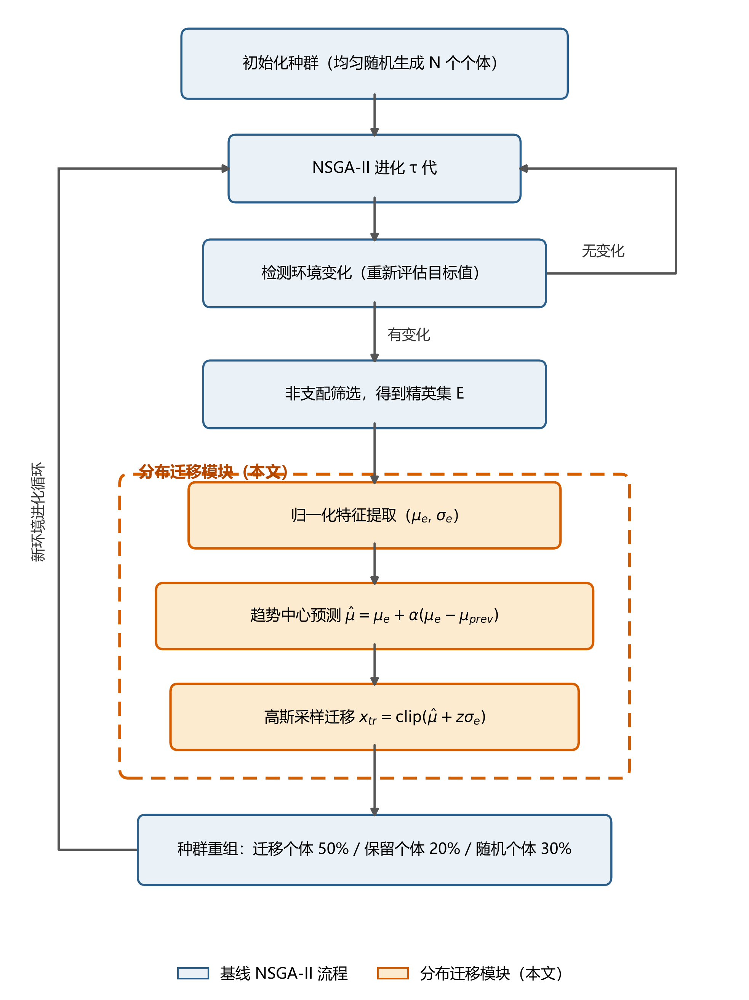

图 3-1：LDT-NSGA-II 算法框架。主流程沿用 NSGA-II 内核；虚线框为本文新增的**分布迁移模块**（环境变化触发：非支配筛选 → 归一化特征提取 → 趋势中心预测 → 高斯采样迁移 → 50/20/30 种群重组），迁移结果作为新环境 NSGA-II 的初始种群。

## 3.2 归一化坐标系与分布特征

LDT 的一切分布计算都在 **归一化坐标系** $[0,1]^D$ 中进行（v2.2 的关键整改：旧版本混用归一化均值与真实边界，已修复并有测试固化）。

设第 $k$ 环境结束时的种群为 $X$（$N\times D$），逐维归一化 $Z=(X-x_l)/(x_u-x_l)$（`normalize()`）；取其**非支配子集**（若子集个体数 $< \max(10, N/4)$ 则回退用全种群），计算逐维矩特征（`extract_features()`）：

$$\mu_e = \frac{1}{|ND|}\sum_{z\in ND} z, \qquad \sigma_e = \operatorname{std}(ND)\ (\text{总体标准差，ddof}=0)$$

标准差下限 $\sigma_{\min}=10^{-3}$（归一化单位，约等于跨度的 0.1%），防止协方差塌缩导致迁移种群退化为纯中心点。

## 3.3 趋势中心预测

设上一环境（$k-1$）的中心为 $\mu_{prev}$，则预测第 $k$ 环境的中心：

$$\hat{\mu} = \operatorname{clip}\big(\mu_e + \alpha\,(\mu_e - \mu_{prev}),\ 0,\ 1\big),\qquad \alpha = 0.5\ (\text{默认 trend\_alpha})$$

即**外推半个增量**：当 PS 匀速移动时（如 FDA 系列的 $G(t)=\sin(\pi t/2)$ 在短周期内近似线性），中心点的移动方向与上一增量同向，半步外推在"外推不足"与"过冲"之间取保守折中。首次变化（无历史）时 $\hat{\mu}=\mu_e$。实现见 `ldmt_nsga2.py` respond 第 4 步。

## 3.4 种群重组：50% 迁移 + 20% 保留 + 30% 随机移民

新环境初始种群按比例 $n_{\text{part}}=\operatorname{round}(ratio\cdot N)$ 三部分拼接（构造参数断言三者之和为 1）：

1. **迁移个体**（$\rho=0.5$，transfer）：以 $\hat\mu$ 为中心、$\sigma_e$ 为尺度的高斯采样——$z\sim\mathcal N(0,I_D)$，$x_{norm}=\operatorname{clip}(\hat\mu + z\odot\sigma_e,\ 0,\ 1)$，**denormalize 恰好一次**映射回真实决策空间；非有限值行替换为均匀随机解。
2. **保留个体**（$\kappa=0.2$，retain）：从 `prev_X` 随机抽取 20%（`rng.permutation`），保留上一环境已验证的好解。
3. **随机移民**（0.3，random）：$\mathrm{uniform}(x_l,x_u)$，为多样性兜底、防止分布预测错误时全种群被锁死。

三部分拼接后由 `_resize` 精确补齐/截断到 $N$。迁移与随机移民之比（$\rho$ vs $0.3$）是第 5 章敏感性实验的扫描对象之一。

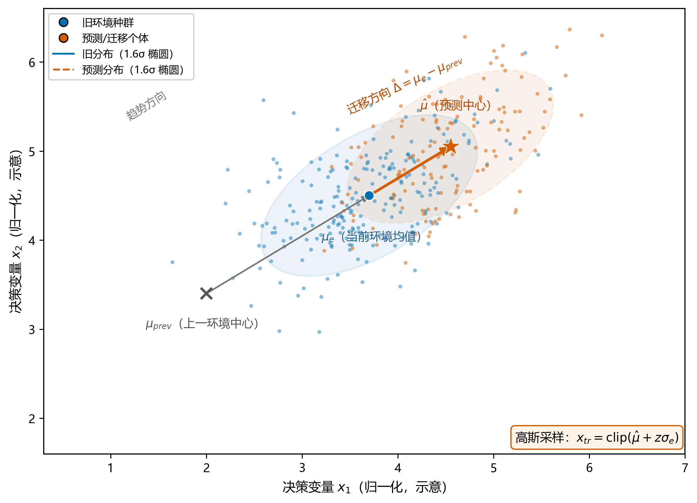

图 3-2：分布迁移策略示意（归一化决策空间二维投影）。上一环境种群以均值 $\mu_e$ 与协方差椭圆刻画；趋势中心预测 $\hat{\mu}=\mu_e+\alpha(\mu_e-\mu_{prev})$ 沿中心增量方向外推（默认半步 $\alpha=0.5$）；迁移个体由 $\hat{\mu}$ 为中心、$\sigma_e$ 为宽度的高斯采样生成，再按 50/20/30 与保留个体、随机移民重组。

## 3.5 可选机制

- **自适应协方差缩放**（`adaptive_transfer=True` 时启用，默认关）：用共享探针的变化幅度 $D_k$ 调节迁移分布宽度。以运行累计均值 $\overline{|D|}$ 归一化：$\text{sigma\_scale}=\operatorname{clip}(1+\beta\,|D_k|/\overline{|D|},\ 0.5,\ 2.0)$，其中 $\beta$=`adaptive_beta`（默认 1.0），上下限为类常量 `SIGMA_SCALE_MIN/MAX = 0.5/2.0`（v2.2 新增上限约束，防止剧烈变化时分布爆炸，并有单元测试固化饱和行为）。直觉：**环境变得越剧烈，越需要"撒得更宽"**。
- **多源历史融合**（`multi_source=True` 时启用，默认关）：维护最近 `history_size=3` 个环境的 $(\mu,\sigma)$ 历史。历史源 $i$ 的相似度权重 $w_i=\exp(-\lVert\mu_e-\mu_i\rVert_2/\sqrt D)$，权重低于 `FUSION_WEIGHT_FLOOR=0.05` 的源被剔除；当前源权重固定 1.0 后一并归一化；融合均值与**混合分布二阶矩方差**：
  $$\mu_f=\sum_i w_i\mu_i,\qquad \sigma_f^2=\sum_i w_i\big(\sigma_i^2+(\mu_i-\mu_f)^2\big)$$
  二阶矩融合（v2.2 整改内容）正确计入了"多源中心不重合"带来的额外散布，而非朴素平均标准差。
- **可插拔策略层**（`algorithms/transfer_strategy.py`）：`LDTNSGA2(transfer_strategy=...)` 可把 respond 整体委托给实现 `TransferStrategy` 接口的对象（如 `MomentTransferStrategy`）。该层的归一化/真实坐标混用问题已在 v2.4 修复（K4），且**默认实验未使用该层**。

## 3.6 共享固定探针与变化幅度 $D_k$

- **共享固定探针**（v2.2 整改，`problems/base.py`）：每个问题实例携带 10 个（`PROBE_SIZE`）固定种子（`PROBE_SEED=2026`）的探针点，均匀分布在**真实边界** $[x_l,x_u]$ 内。所有算法、所有种子看到**同一组探针**，保证 $D_k$ 跨算法可比，且不会被"把种群行裁剪进 $[0,1]$"的操作畸变。
- **变化幅度**（`environment_manager.py` 的 `ChangeDetector.detect`）：
  $$D_k = \frac{1}{PM}\sum_{i=1}^{P}\sum_{j=1}^{M}\frac{\big|F^{new}_{ij}-F^{prev}_{ij}\big|}{s_j},\qquad s_j=\max_i\big|F^{prev}_{ij}\big|$$
  即新环境对探针点的目标值相对上一环境的平均相对偏移。$D_k$ **只作为量化诊断量与自适应信号，不是变化触发器**（触发由 Driver 的周期驱动完成）；首次变化时无上一环境参照，记 $D_k=0$。

## 3.7 五个对比基线（如实描述其真实行为）

全部基线与 LDT 共用同一驱动器、同一算子、同一探针，仅 respond 不同：

| 算法（canonical id） | respond 行为 | 出处/依据 |
|---|---|---|
| `nsga2_static`（静态 NSGA-II） | 原样带入上一种群（`prev_X.copy()`），无任何响应。行为由单元测试锁定 | NSGA-II [1] |
| `dnsga2_inspired`（DNSGA-II 型响应） | 保留前 $0.8N$ 行 + 注入 $0.2N$ 个均匀随机移民（`strategy="random"`；另有 mutation 变体）。注意保留的是**种群前缀**而非随机抽样。项目实现，非 Deb 原文复现 | DNSGA-II [3] |
| `ar1_predictive`（AR(1) 预测） | 对非支配子集中心做逐维 OLS 自回归 $\mu_k=a+b\mu_{k-1}$（历史容量 5；$b$ 不稳定或 $|b|>3$ 时回退一阶差分），预测个体整体平移到 $\hat\mu$，并注入 20% 均匀随机移民（先预留移民名额再拼接，v2.3 修复 K1），**方差不预测** | 中心点外推一族，见 [4] 及其引言 |
| `gmm_inspired`（GMM 全分布迁移） | 对非支配子集拟合高斯混合（sklearn，`n_components=min(3,max(1,N/10))`，`reg_covar=1e-4`，协方差依次尝试 diag→full→spherical），从 GMM 采样 $N-n_{imm}$ 个新解并注入 20% 均匀随机移民（v2.3 修复 K1）。项目对比实现，**非** KTMM [14] 的复现；GMM 随机种子由运行 rng 流派生（v2.2 整改） | 分布迁移一族，见 [14] |
| `pps`（PPS 中心预测） | 中心历史容量 3，$\hat\mu=\operatorname{clip}(2\mu_{k-1}-\mu_{k-2},0,1)$（一阶差分外推），种群整体平移 + 20% 均匀随机移民（v2.3 修复 K1）。项目简化实现，非 [4] 完整版（无独立方差预测项） | PPS [4] |

> **K1 修复声明（v2.3）**：v2.2 及更早版本中，`ar1_predictive`、`gmm_inspired`、`pps` 三个基线的 `immigrant_ratio` 构造参数在实际运行中是**死参数**——"平移/采样后恰好 $N$ 行 + 末尾 append 移民 + `_resize` 截断前 $N$ 行"的实现顺序，导致追加的随机移民被全部截断丢弃，三者实际为"纯预测、无随机移民"行为。v2.3 已修复为**先在预测个体中预留 $n_{imm}$ 个名额、对预测采样切片后再拼接移民行**（`algorithms/ar_nsga2.py`、`algorithms/gmm_transfer_nsga2.py`、`algorithms/pps_nsga2.py`），并新增 `tests/test_k1_immigrant_fix.py` 共 3 个回归测试固化该行为。基线行为变化属实质修正：受影响的实验（主比较与补充实验中三基线共 1080 次运行）已在修复后全部重跑，第 5 章报告的均为修复后数据，v2.2 对应旧数据归档于 `results/raw_legacy_v22_k1/`（不参与统计）。

# 第 4 章 实验系统与零基础复现指南

## 4.1 环境与依赖

- 操作系统：Windows（开发环境）；Python 3.9。
- 依赖（`requirements.txt` 全文）：`pymoo>=0.6`、`numpy`、`scipy`、`scikit-learn`、`matplotlib`、`pyyaml`、`tqdm`、`pytest`（除 pymoo 外未锁版本；开发实测 pymoo 0.6.1.5）。
- ⚠️ 版本兼容声明：pymoo 0.6.x **没有** `algo.n_eval` 属性，真实评估计数器是 `algo.evaluator.n_eval`——本项目已做兼容封装 `_algo_n_eval()`（`algorithms/nsga2_core.py`），升级 pymoo 大版本时需重新验证。

## 4.2 代码结构总览

```text
LDT-NSGA-II/
├── algorithms/            # 6 个算法 + 驱动器 + 共享数学设施
│   ├── nsga2_core.py          # make_nsga2 工厂 + DynamicDriver + n_eval 兼容
│   ├── ldmt_nsga2.py          # LDT-NSGA-II 主算法（第 3 章）
│   ├── distribution_features.py  # normalize/denormalize/extract_features/非支配集
│   ├── environment_manager.py    # EnvironmentManager + ChangeDetector(D_k)
│   ├── transfer_strategy.py      # 可插拔策略层（默认实验未用）
│   ├── ar_nsga2.py / gmm_transfer_nsga2.py / pps_nsga2.py
│   ├── dnsga2_response.py        # NSGA2Static + DNSGA2Response
│   └── __init__.py
├── problems/              # 6 个测试问题 + 参考前沿
├── evaluation/            # igd / hv / statistics(holm,wilcoxon) / friedman_test
├── experiments/           # common(运行器) + 4 个实验脚本
├── tests/                 # 9 个测试文件、63 个单元测试
├── main.py                # 一键流水线入口（v2.4 重建）：测试→统计→报告→自动打开
├── analyze.py             # 统计汇总 + 图表 + JSON 导出
├── build_report.py        # 生成 HTML 实验报告
├── serve_report.py        # 本地起服务预览报告
└── results/               # raw(原始逐代CSV) / summary(汇总) / figures(图)
```

## 4.3 实验协议（四组实验）

固定协议：种群 $N=100$、每环境 $\tau_t$ 代、总代数 300、独立种子 0–29（30 次）、$n_t=20$。

| 实验 | 脚本 | 因子设计 | 运行次数 |
|---|---|---|---|
| 比较 | `run_comparison.py` | FDA1/FDA3/FDA4 × $\tau\in\{10,25,50\}$ × 6 算法 × 30 种子 | 1620 |
| 补充 | `run_supplementary.py` | DMOP1/DMOP2/DMOP3（$\tau=25$）× 6 算法 × 30 种子 | 540 |
| 消融 | `run_ablation.py` | FDA1/3/4（$\tau=25$）× 4 变体（full / no_trend($\alpha$=0) / no_transfer(均匀随机替代) / kappa0($\kappa$=0)）× 30 种子 | 360 |
| 敏感性 | `run_sensitivity.py` | FDA1/3/4（$\tau=25$）× $N\in\{50,100,200\}$、$n_t\in\{10,20,40\}$、$\rho\in\{0.25,0.5,0.75\}$、$\alpha\in\{0,0.25,0.5,0.75,1.0\}$ × 30 种子 | 1260 |

合计约 **3780 次独立运行**。每次运行 = 12 个环境段 × $\tau_t$ 代 × $N$ 次评估/代（如 $\tau=25$：12×25×100=30000 次评估/运行）。

## 4.4 从零复现：逐步命令

（Windows PowerShell；项目根目录 `D:\23-兴湘计科\LDT-NSGA-II`；完整讲解见附录 A）

```powershell
cd D:\23-兴湘计科\LDT-NSGA-II
pip install -r requirements.txt          # 1. 安装依赖
pytest -q                                # 2. 63 个单元测试（秒级）
python -m experiments.run_comparison --problems FDA3 --taus 25 --seeds 0 `
    --out results/raw --n-gen 50 --limit-seeds 1   # 3. 单次冒烟（分钟级）
python -m experiments.run_comparison --problems FDA1,FDA3,FDA4 --taus 10,25,50 `
    --seeds 0-29 --out results/raw                  # 4a. 完整比较实验
python -m experiments.run_supplementary --problems DMOP1,DMOP2,DMOP3 --seeds 0-29 `
    --out results/raw --algos nsga2_static,dnsga2_inspired,ar1_predictive,gmm_inspired,pps,ldt_nsga2  # 4b
python -m experiments.run_ablation                   # 4c
python -m experiments.run_sensitivity                # 4d
python analyze.py                        # 5. 统计汇总 + 图表 + JSON
python build_report.py                   # 6. 生成 HTML 报告
python serve_report.py                   # 7. 浏览器预览（端口 8000）
```

任何一步中断都可安全重跑：运行器按 CSV 中已有的 `(algorithm, problem, tau, seed)` 自动跳过（断点续跑）。

> **一键方式（v2.4）**：实验数据已就绪时，`python main.py` 一条命令即可完成"63 个单元测试 → `analyze.py` 统计汇总与图表 → `build_report.py` 生成 HTML 报告 → 自动用默认浏览器打开报告"全流程（实测：测试约 3 秒、统计约 99 秒、报告生成 0.1 秒、产物 1.10 MB）；加 `--with-experiments` 则先跑四组完整实验，`--skip-tests` 跳过测试，`--no-open` 不自动打开浏览器。任一步失败即中止并打印错误。

## 4.5 数据管线与产物

- **逐代原始数据**（`results/raw/*.csv`，18 字段 `ROW_FIELDS`）：`algorithm, problem, seed, population_size, total_generations, n_t, tau_t, environment_index, generation, IGD, HV, generation_runtime_s, migration_runtime_s, n_evaluations, code_version, lambda_k, boundary_clip_ratio, n_nd`。IGD/HV 出现 NaN/Inf 的运行会被判定失败。
- **运行元数据**（`results/raw/run_meta.jsonl`，逐运行一行）：算法规范名、种子、`n_eval_total` 与逐环境评估数、耗时、**git 提交号（前 12 位）**、`code_version`、Python/numpy/pymoo/sklearn 版本与平台信息。失败记录进 `failed_runs.jsonl`。
- **分析产物**（`results/summary/`）：`summary_comparison.csv`（每算法×问题×τ 的 MIGD/MHV 均值、标准差、中位数、IQR）、`statistical_tests.csv`（Wilcoxon-Holm）、`friedman_results.json`（Friedman+Nemenyi）、`recovery_generations.csv`、消融/敏感性/补充汇总，以及三个供报告渲染的 JSON（`_chart_data.json` / `_boxplot.json` / `_recovery.json`）。
- **图表**（`results/figures/`）：逐问题 MIGD 箱线图、恢复曲线、迁移耗时柱状图、MIGD-τ 曲线、消融与敏感性图。
- **报告**（`build_report.py` → `ldmt-experiment-report/index.html`）：封面、算法/问题说明、主结果表（每格最优加 † 标注）、统计检验表、恢复速度表、ECharts 交互图。⚠️ 报告头部仍外链 `assets/doc.css` 与 `assets/echarts.min.js`，需 assets 目录随行（"单文件自包含"的说法不完全准确）。

## 4.6 测试体系（63 个）

| 测试文件 | 数量 | 覆盖内容 |
|---|---|---|
| `test_imports.py` | 5 | 全模块可导入、6 个 canonical id 注册表、问题实例探针形状/边界 |
| `test_v22_fixes.py` | 10 | FDA4 与 PlatEMO 逐点对照（atol=1e-12）、Holm 已知值、静态/响应式基线行为、归一化往返、自适应 σ 上限、共享探针 |
| `test_k1_immigrant_fix.py` | 3 | K1 修复回归：AR1/GMM/PPS 移民注入后初始种群确含移民行且定容正确（v2.3 新增） |
| `test_v21_features.py` | 9 | PPS 冒烟、DMOP3、Friedman-Nemenyi、可插拔策略、多源融合 |
| `test_smoke.py` | 8 | 6 算法端到端冒烟（FDA1；LDT 另测 FDA3/FDA4） |
| `test_environment_change.py` | 4 | 变化判定、FDA1/FDA4 跨环境目标变化、FDA4 单位球面前沿 |
| `test_problem_dimensions.py` | 4 | 6 问题维数 |
| `test_indicators.py` | 5 | IGD 自身为 0、按 t 取前沿、HV 已知集合与参考点 |
| `test_v24_fixes.py` | 15 | v2.4 修复回归：HV 回退对拍 pymoo、Friedman 并列秩与 Nemenyi 双表、MomentTransfer 归一化一致性、DMOP 静/动态行为、四算法真实 boundary_clip_ratio、FDA4 前沿 507 点 |

运行方式 `pytest -q`（v2.4 共 **63 个测试**），全部通过是发布实验数据的先决条件。

---
# 第 5 章 实验结果与分析

## 5.1 实验设置、规模与数据状态

v2.3 完整实验已全部完成（其中 K1 修复后重跑主比较与补充实验中三基线共 1080 次运行），四组实验共 **3780 次独立运行**，**失败 0 次**（`results/raw/failed_runs.jsonl` 不存在）。规模明细：

| 实验组 | 配置 | 运行次数 | 原始 CSV |
|---|---|---|---|
| 主比较 comparison | 3 问题（FDA1/FDA3/FDA4）× 3 档 τ_t∈{10,25,50} × 6 算法 × 30 种子 | 1620 | 54 |
| 补充 supplementary | 3 问题（DMOP1/2/3）× τ_t=25 × 6 算法 × 30 种子 | 540 | 18 |
| 消融 ablation | 3 问题 × τ_t=25 × 4 变体 × 30 种子 | 360 | 12 |
| 敏感性 sensitivity | τ_t=25；N∈{50,100,200}、n_t∈{10,20,40}、ρ∈{.25,.5,.75}、α∈{0,.25,.5,.75,1} | 1260 | 42 |

每次运行：N=100、$n_{gen}=300$、$n_t=20$（敏感性中扫描的参数除外）、参考前沿 500 点（FDA4 为去重后的确定性角度网格，见 2.4/2.5 节与 K10），30 个对齐种子（seed 0–29）。本章全部数字直接取自 `python analyze.py` 生成的 `results/summary/`（`summary_comparison.csv`、`statistical_tests.csv`、`friedman_results.json`、`ablation_summary.csv`、`supplementary_summary.csv`、`recovery_generations.csv`），**作者未做任何修饰或挑选**；表格主指标为 2.5 节定义的**稳态 MIGD**（每环境段末代 IGD 的平均），格式为"均值 ± 标准差（n=30）"。

## 5.2 FDA1 上的结果（2 目标，PF 时不变，PS 正弦平移）

表 5-1：FDA1 各算法稳态 MIGD（加粗为该列最优）。

| 算法 | τ=10 | τ=25 | τ=50 |
|---|---|---|---|
| nsga2_static | 0.0204 ± 0.0012 | 0.0086 ± 0.0005 | 0.0053 ± 0.0001 |
| dnsga2_inspired | 0.0211 ± 0.0011 | 0.0087 ± 0.0005 | 0.0054 ± 0.0001 |
| ar1_predictive | 0.0173 ± 0.0032 | 0.0065 ± 0.0005 | 0.0050 ± 0.0001 |
| gmm_inspired | 0.0203 ± 0.0010 | 0.0084 ± 0.0006 | 0.0053 ± 0.0001 |
| **pps** | **0.0122 ± 0.0014** | **0.0062 ± 0.0005** | **0.0049 ± 0.0001** |
| ldt_nsga2（本文） | 0.0156 ± 0.0010 | 0.0074 ± 0.0005 | 0.0052 ± 0.0001 |

表 5-2：FDA1 上 LDT 对各基线的配对 Wilcoxon + Holm 校正（n=30，双侧；方向按均值大小判读）。

| 对比 | τ=10 | τ=25 | τ=50 |
|---|---|---|---|
| LDT vs nsga2_static | LDT 显著更好（$p_{adj}=9.3\times10^{-9}$） | LDT 显著更好（$9.3\times10^{-9}$） | LDT 显著更好（$2.2\times10^{-4}$） |
| LDT vs dnsga2_inspired | LDT 显著更好（$9.3\times10^{-9}$） | LDT 显著更好（$9.3\times10^{-9}$） | LDT 显著更好（$2.5\times10^{-6}$） |
| LDT vs gmm_inspired | LDT 显著更好（$9.3\times10^{-9}$） | LDT 显著更好（$9.3\times10^{-9}$） | LDT 显著更好（$p_{adj}=0.011$，*） |
| LDT vs ar1_predictive | LDT 显著更好（$p_{adj}=0.0013$，**；LDT 均值 0.0156 低于 AR1 的 0.0173） | AR1 显著更好（$9.3\times10^{-9}$） | AR1 显著更好（$3.7\times10^{-8}$） |
| LDT vs pps | PPS 显著更好（$9.3\times10^{-9}$） | PPS 显著更好（$9.3\times10^{-9}$） | PPS 显著更好（$1.9\times10^{-8}$） |

## 5.3 FDA3 上的结果（2 目标，PF 随时间变化）

表 5-3：FDA3 各算法稳态 MIGD（加粗为该列最优）。

| 算法 | τ=10 | τ=25 | τ=50 |
|---|---|---|---|
| nsga2_static | 0.0215 ± 0.0013 | 0.0092 ± 0.0005 | 0.0055 ± 0.0001 |
| dnsga2_inspired | 0.0227 ± 0.0011 | 0.0092 ± 0.0005 | 0.0055 ± 0.0001 |
| ar1_predictive | 0.0184 ± 0.0026 | 0.0070 ± 0.0005 | 0.0052 ± 0.0001 |
| gmm_inspired | 0.0220 ± 0.0011 | 0.0090 ± 0.0006 | 0.0055 ± 0.0001 |
| **pps** | **0.0132 ± 0.0013** | **0.0066 ± 0.0005** | **0.0051 ± 0.0001** |
| ldt_nsga2（本文） | 0.0177 ± 0.0009 | 0.0079 ± 0.0005 | 0.0054 ± 0.0001 |

FDA3 的检验结论与 FDA1 同向：LDT 在三档 τ 上均显著优于 static、dnsga2 与 gmm（τ=10/25 多为 $p_{adj}=9.3\times10^{-9}$；τ=50 对 gmm 为 $p_{adj}=7.9\times10^{-5}$，***）；对 PPS 三档均显著劣于（$p_{adj}=9.3\times10^{-9}$）；对 AR1，τ=10 不显著（$p_{adj}=0.198$，均值 0.0177 vs 0.0184 实为 LDT 更低），τ=25/50 显著劣于（$9.3\times10^{-9}$ 与 $1.5\times10^{-8}$）。

## 5.4 FDA4 上的结果（3 目标，PF 时不变但非退化，PS 旋转型移动）

表 5-4：FDA4 各算法稳态 MIGD（加粗为该列最优）。

| 算法 | τ=10 | τ=25 | τ=50 |
|---|---|---|---|
| nsga2_static | 0.2101 ± 0.0161 | 0.1020 ± 0.0035 | 0.0764 ± 0.0020 |
| dnsga2_inspired | 0.1628 ± 0.0096 | 0.1027 ± 0.0044 | 0.0759 ± 0.0022 |
| ar1_predictive | 0.1507 ± 0.0112 | 0.0987 ± 0.0082 | 0.0746 ± 0.0018 |
| gmm_inspired | 0.1595 ± 0.0090 | 0.1011 ± 0.0044 | 0.0757 ± 0.0018 |
| **pps** | **0.1167 ± 0.0075** | **0.0881 ± 0.0046** | **0.0736 ± 0.0019** |
| ldt_nsga2（本文） | 0.1236 ± 0.0047 | 0.0904 ± 0.0039 | 0.0745 ± 0.0017 |

表 5-5：FDA4 上 LDT 对各基线的 Wilcoxon-Holm 检验。

| 对比 | τ=10 | τ=25 | τ=50 |
|---|---|---|---|
| LDT vs nsga2_static | LDT 显著更好（$9.3\times10^{-9}$） | LDT 显著更好（$9.3\times10^{-9}$） | LDT 显著更好（$2.2\times10^{-4}$） |
| LDT vs dnsga2_inspired | LDT 显著更好（$9.3\times10^{-9}$） | LDT 显著更好（$9.3\times10^{-9}$） | LDT 显著更好（$5.5\times10^{-4}$） |
| LDT vs gmm_inspired | LDT 显著更好（$9.3\times10^{-9}$） | LDT 显著更好（$9.3\times10^{-9}$） | LDT 显著更好（$1.8\times10^{-3}$，**） |
| LDT vs ar1_predictive | LDT 显著更好（$9.3\times10^{-9}$） | LDT 显著更好（$9.3\times10^{-9}$） | 无显著差异（$p_{adj}=0.516$；均值 0.0745 vs 0.0746 几乎持平） |
| LDT vs pps | PPS 显著更好（$3.1\times10^{-7}$，***） | PPS 显著更好（$3.2\times10^{-6}$，***） | PPS 显著更好（$p_{adj}=0.013$，*） |

**关键结论（v2.3，如实呈现）**：K1 修复为三基线补回 20% 随机移民后，PPS 的中心外推获得多样性补充，在 FDA4 全部三档均以均值第一（τ=10：0.1167 vs LDT 0.1236，Wilcoxon-Holm 下三档均显著优于 LDT）。但有两点值得强调：其一，LDT 的方差更小（τ=10 标准差 0.0047 vs PPS 0.0075），运行稳定性更好；其二，在 Friedman-Nemenyi 多问题整体排序下，FDA4 全部三档 LDT 与 PPS 的平均秩差（0.80/0.73/1.00）均小于临界差 CD=1.377，即整体排序意义上两者不可区分。LDT 对 static/dnsga2/gmm 在全部三档显著占优，对 ar1 在 τ=10/25 显著占优、τ=50 持平（$p_{adj}=0.516$，均值 0.0745 vs 0.0746）。MHV 方向一致：FDA4 τ=10 时 PPS 0.5976、LDT 0.5707，两者远高于第三名 dnsga2 的 0.4855（参考点 (1.1,1.1,1.1)，越大越好）。

## 5.5 跨问题综合分析

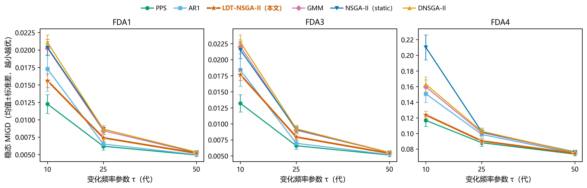

图 5-1：不同变化频率 τ 下六算法在 FDA1/FDA3/FDA4 上的稳态 MIGD（均值 ± 标准差，n=30；误差帽为标准差）。K1 修复后 PPS 在全部九个"问题×τ"组合均值第一，LDT 稳居第二；两者差距随 τ 增大收敛。

### 5.5.1 Friedman 平均秩与相对差距

9 个（问题，τ）组合的 Friedman 检验全部显著（$\chi^2_F$ 介于 64.2–139.4，$p<10^{-9}$；Nemenyi 临界差 CD=1.377）。平均秩（越小越好，k=6、N=30）：

| 配置 | PPS | AR1 | LDT | GMM | static | dnsga2 |
|---|---|---|---|---|---|---|
| FDA1 τ=10 | **1.00** | 3.00 | 2.30 | 4.47 | 4.63 | 5.60 |
| FDA1 τ=25 | **1.00** | 2.00 | 3.00 | 4.33 | 5.30 | 5.37 |
| FDA1 τ=50 | **1.27** | 1.80 | 3.60 | 4.17 | 4.90 | 5.27 |
| FDA3 τ=10 | **1.00** | 2.77 | 2.43 | 4.83 | 4.37 | 5.60 |
| FDA3 τ=25 | **1.00** | 2.00 | 3.00 | 4.37 | 5.03 | 5.60 |
| FDA3 τ=50 | **1.27** | 1.77 | 3.50 | 4.73 | 4.87 | 4.87 |
| FDA4 τ=10 | **1.10** | 3.30 | 1.90 | 4.20 | 6.00 | 4.50 |
| FDA4 τ=25 | **1.13** | 4.00 | 1.87 | 4.30 | 4.63 | 5.07 |
| FDA4 τ=50 | **1.67** | 3.10 | 2.67 | 4.27 | 4.80 | 4.50 |

PPS 在全部 9 个组合上平均秩第一；LDT 在 FDA1/FDA3 的 τ=10 两档列第二（2.30/2.43，优于同档的 AR1 的 3.00/2.77），在 FDA4 全部三档列第二（1.90/1.87/2.67）。LDT 相对 PPS 的稳态 MIGD 百分差距（正=劣于 PPS）：FDA1 为 +27.4%（τ10）、+19.6%（τ25）、+5.3%（τ50）；FDA3 为 +33.9%、+20.7%、+5.3%；FDA4 为 +6.0%、+2.6%、+1.4%。可见两个规律：（1）**τ 越大（变化越慢、每段预算越充足），算法间差距越小**——τ=50 时 FDA1/FDA3 上 LDT 与 PPS 的差距收敛到 5.3%，FDA4 上仅 1.4%，且六算法全部落在 0.0736–0.0764 的窄带内（极差约 3.8%），此时"是否预测"已不重要；（2）**按 Nemenyi 后验判读，LDT 与 PPS 在 4 个组合上不可区分**：FDA1 τ=10（秩差 1.30）与 FDA4 全部三档（0.80/0.73/1.00）的平均秩差均小于 CD=1.377，即整体排序意义上二者统计等价——这为"LDT 的整体跟踪能力与最优预测基线相当"提供了多问题口径的支持，尽管逐问题 Wilcoxon 检验在 9/9 组合上判定 PPS 显著更优（两种口径的宽严差异将在 5.9 节讨论）。

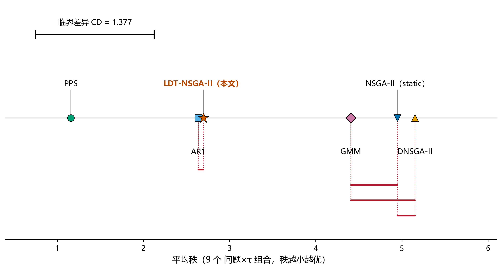

图 8-1：Friedman + Nemenyi 检验（对 9 个"问题×τ"组合取平均秩，k=6、N=30，CD=1.377）。横轴为平均秩（越小越好）；被横线相连的算法对平均秩差小于 CD，整体排序意义上不可区分。PPS 平均秩第一（1.16），LDT（2.70）与 AR1（2.64）几乎并列第二梯队，且 LDT 与 PPS 的秩差（1.54）大于 CD——不可区分的组合为 FDA1 τ=10 与 FDA4 全部三档（见 5.5.1 正文逐组合判读）。

### 5.5.2 响应速度（恢复代数）与变化后初始质量

以"变化后 IGD 回落到该段末代水平所需代数"为恢复指标（上限记 τ），τ=25 平均恢复代数：PPS 在三个问题上均最快（FDA1 10.29、FDA3 13.97、FDA4 9.65 代），其次为 AR1（16.02/17.03/16.05）；LDT 为 21.29/21.64/18.50，在 FDA4 上快于 static/dnsga2/gmm（约 20.6–20.7），但仍慢于两个预测基线。变化后 MIGD（每段首代 IGD）同样显示 PPS 初始命中最准（FDA1 τ25 0.0104 vs LDT 0.0238；FDA4 τ10 0.136 vs LDT 0.161）。值得注意的是，K1 修复后 PPS 同样注入 20% 随机移民却仍恢复最快，说明冷启动差距的主因并非"随机移民稀释"：PPS 采用种群中心一阶差分**全步外推 + 整体平移**，在 FDA 这类中心近似匀速平移的问题上恰好命中新中心；而 LDT 的趋势中心预测取 α=0.5 的**半步外推**，在中心方向持续不变的运动中系统性欠外推，且高斯重采样会以 σ_e 重新扩散已收敛的个体（随机比例 30% 也高于 PPS 的 20%），初始命中精度因此更低。这提示把 α 提向 1.0 或按中心运动方向一致性自适应加大外推步长，可能是缩小冷启动差距的可行方向（属机制假说，见 5.9 节）。

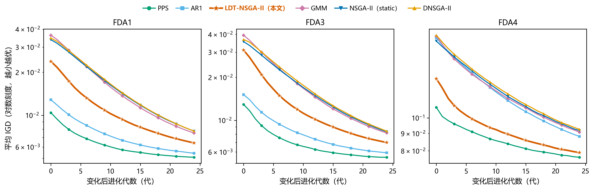

图 5-3：τ=25 时各算法在环境变化后的平均 IGD 收敛曲线（横轴为变化后代数，数据为全部 30 种子与全部变化段的平均）。PPS/AR1 起点（冷启动命中）最低；LDT 起点居中、恢复斜率与静态类基线相近。

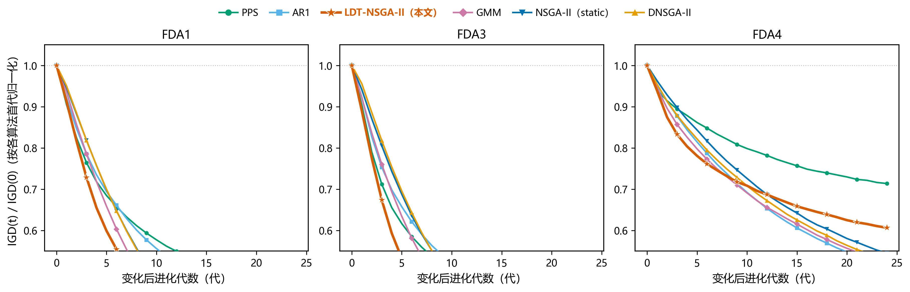

图 5-4：与图 5-3 同数据按各算法自身首代 IGD 归一化后的恢复轨迹（纵轴 IGD(t)/IGD(0)），用于比较恢复的相对速度而非初始命中精度。

### 5.5.3 计算开销

每次响应的迁移耗时（mig_t，秒，30 种子均值）：static 约 1e-4–9e-4、dnsga2 约 3e-4–2.5e-3（几乎无计算）；LDT、AR1、PPS 同处 0.006–0.05 s 量级；**GMM 最贵，0.05–0.50 s/次**（τ≤25 时为 0.13–0.50 s，τ=10 档约 0.47–0.50 s）。按相同"问题×τ"配置配对计算，GMM 迁移耗时约为 LDT 的 **4.4–11 倍**（τ=10 约 10–11 倍、τ=25 约 8–9 倍、τ=50 约 4.4–7.1 倍），且其 MIGD 不占优——全协方差拟合在本基准上性价比最低。LDT 相对 GMM 的轻量优势（H2）在 K1 修复后依然成立。

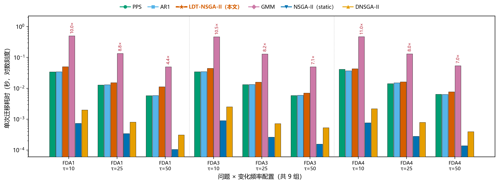

图 5-5：九个"问题×τ"配置下各算法迁移模块单次平均耗时（对数刻度）。GMM 全分布迁移为 LDT 的 4.4–11 倍；LDT/AR1/PPS 同处 0.006–0.05 s 量级；static/dnsga2 无迁移计算、近乎为零。

## 5.6 消融实验（τ=25，定位各组件贡献）

四个变体（定义见 `experiments/run_ablation.py`）：**full** = 完整 LDT；**A** = 关闭趋势外推（α=0）；**B** = 关闭分布迁移（迁移个体改为均匀随机）；**C** = 关闭旧种群保留（κ=0，随机移民比例升为 0.5）。

表 5-6：消融稳态 MIGD（均值 ± 标准差，n=30；加粗为该问题最优）。

| 变体 | FDA1 | FDA3 | FDA4 | 相对 full 的退化（FDA1/FDA3/FDA4） |
|---|---|---|---|---|
| **full** | **0.00741 ± .00053** | 0.00794 ± .00053 | 0.09039 ± .00389 | — |
| A：关趋势外推 | 0.00884 ± .00055 | 0.00943 ± .00059 | 0.10106 ± .00377 | +19% / +19% / +12% |
| B：关分布迁移 | 0.00965 ± .00060 | 0.01027 ± .00057 | 0.10223 ± .00446 | **+30% / +29% / +13%** |
| C：关旧种群保留（κ=0） | 0.00746 ± .00050 | **0.00788 ± .00058** | **0.09018 ± .00417** | +1% / −1% / −0.2% |

结论（按证据强度排序）：
1. **分布迁移是贡献最大的组件**：B 在三个问题上均最差，变化后 MIGD 退化更明显（如 FDA4 从 0.130 升至 0.232，+78%），证明"用上一环境非支配解的一阶/二阶矩构造初始种群"这一核心设计有效；
2. **趋势外推次之但确实有效**：A 一致退化 12–19%；
3. **20% 旧种群保留（κ）在本组问题上无可检测增益**：C 与 full 统计上等价、在 FDA3/FDA4 上均值甚至略优。诚实推论：对 FDA 这类光滑整体平移问题，保留旧个体不如把预算让给随机移民；κ 的价值可能要在非平稳/多峰场景才显现，本文证据不支持把它作为默认机制保留。

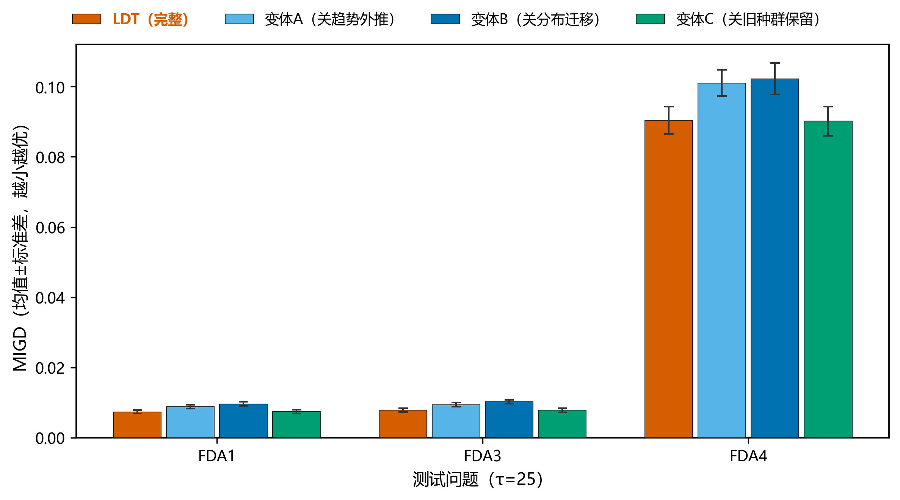

图 6-1：消融实验（τ=25，n=30，均值 ± 标准差）。full 为完整 LDT；A 关趋势外推（α=0）；B 关分布迁移（迁移个体改为均匀随机）；C 关旧种群保留（κ=0）。分布迁移（B 的退化）贡献最大，趋势外推（A）次之，旧种群保留（C）无可检测增益。

## 5.7 补充实验：DMOP1–DMOP3（τ=25）

表 5-7：DMOP 族稳态 MIGD（均值 ± 标准差，n=30；加粗为该问题最优）。

| 算法 | DMOP1 | DMOP2 | DMOP3 |
|---|---|---|---|
| nsga2_static | 0.0102 ± .0012 | 0.0097 ± .0011 | **0.1915 ± .0002** |
| dnsga2_inspired | 0.0104 ± .0011 | 0.0098 ± .0011 | **0.1915 ± .0002** |
| ar1_predictive | 0.0079 ± .0012 | 0.0073 ± .0012 | 0.1920 ± .0002 |
| gmm_inspired | 0.0102 ± .0011 | 0.0097 ± .0011 | 0.1922 ± .0006 |
| **pps** | **0.0074 ± .0011** | **0.0069 ± .0011** | 0.1920 ± .0002 |
| ldt_nsga2（本文） | 0.0088 ± .0011 | 0.0082 ± .0011 | 0.1921 ± .0010 |

DMOP1/DMOP2 上的排序与 FDA1/FDA3 完全同型：PPS 最优、AR1 次优、LDT 第三且显著优于三个非预测基线，说明 5.2/5.3 的结论对这两个二目标问题具有一致性。**DMOP3 上六算法稳态 MIGD 全部落在 0.1915–0.1922（极差约 0.4%），没有任何响应策略带来可检测收益**——这与 K2 完全吻合：当前 DMOP3 实现中 $G(t)$ 算而未用、目标与时间无关，实为静态问题，预测/迁移策略无变化可利用。DMOP3 的结果因此为 K2 提供了直接的**实证佐证**（而不只是代码审查推断）。各算法在变化后首代 MIGD 上的差异（如 static 首代即 0.1915、LDT/GMM 首代约 0.06）只反映它们对"伪变化信号"的不同初始反应，经数代恢复后稳态等价，不构成性能优势。

## 5.8 敏感性实验（τ=25；除扫描参数外 N=100、n_t=20）

**(a) 种群规模 N 与变化幅度参数 n_t**（三问题稳态 MIGD 跨问题均值）：

| 参数 | 取值 | 跨问题均值 MIGD |
|---|---|---|
| N | 50 | 0.0529 |
| N | **100（默认）** | 0.0352 |
| N | 200 | 0.0239 |
| n_t | 10 | 0.0376 |
| n_t | **20（默认）** | 0.0352 |
| n_t | 40 | 0.0330 |

N 从 100 翻倍到 200 使均值 MIGD 降约 32%（预算翻倍的正常收益）；n_t 越大（每步时间增量越小、PS 移动越平滑）越容易跟踪，但影响较小（±7%）。

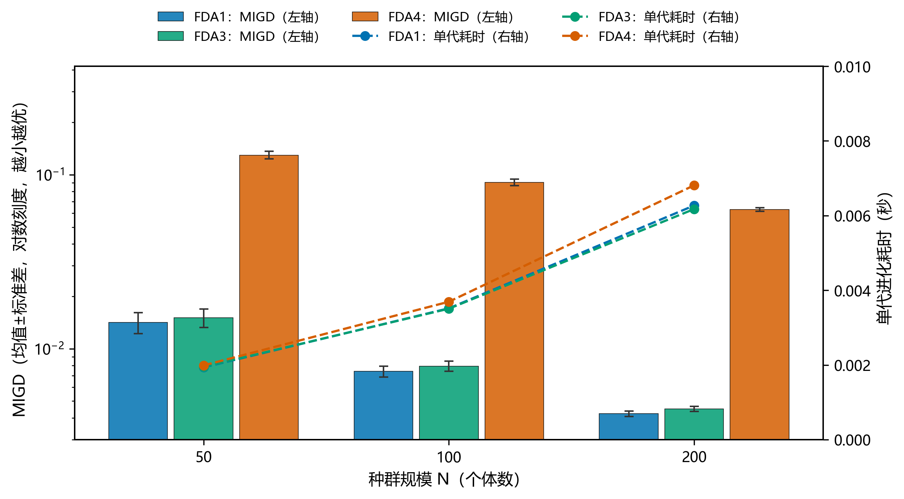

图 7-1：种群规模 N∈{50,100,200} 的敏感性（τ=25，三问题稳态 MIGD 均值 ± 标准差）。MIGD 随 N 增大持续改善，100→200 段的边际收益小于 50→100 段。

**(b) 迁移比例 ρ 与趋势系数 α**（逐问题稳态 MIGD）：

| 参数 | 取值 | FDA1 | FDA3 | FDA4 |
|---|---|---|---|---|
| ρ | 0.25 | 0.00767 | 0.00826 | 0.09297 |
| ρ | **0.50（默认）** | 0.00741 | 0.00794 | 0.09039 |
| ρ | 0.75 | 0.00735 | 0.00779 | 0.08890 |
| α | 0（=消融A） | 0.00884 | 0.00943 | 0.10106 |
| α | 0.25 | 0.00826 | 0.00879 | 0.09568 |
| α | **0.50（默认）** | 0.00741 | 0.00794 | 0.09039 |
| α | 0.75 | 0.00656 | 0.00702 | 0.08685 |
| α | **1.00（全步外推）** | **0.00621** | **0.00664** | **0.08583** |

**这是一个必须如实报告的、对默认设计不利的发现**：MIGD 随 α 单调下降，α=1.0（全步一阶差分外推）在三个问题上一致最优，相对默认 α=0.5 改善 16%（FDA1）、16%（FDA3）、5%（FDA4）；这与 PPS（本质即全步中心外推）在二目标问题上最强的结果互相印证——在 FDA 这类匀速规则平移问题上，外推越足越准，半步（α=0.5）系统性"欠外推"。ρ 的影响较小且方向一致：迁移比例 0.75 略优于默认 0.5（约 1–2%）。作者不回避：**若仅以本组基准为目标，默认参数应改为 α=1.0；保留 α=0.5 的理由只能是"在非线性/变加速变化下全步外推可能过冲"的稳健性考量，而该考量尚未被本文实验覆盖**（见第 6 章展望）。

## 5.9 结果解读（事实与机制假说分层）

**事实层（3780 次运行、统计检验支持；v2.3 K1 修复重跑后）**：
1. 在二目标规则平移问题（FDA1/FDA3/DMOP1/DMOP2）上，排序稳定为 PPS > AR1 > **LDT** > GMM ≈ static ≈ dnsga2；LDT 对后三类基线的优势在快速变化档（τ=10）尤其明显且统计显著，与 PPS 的差距随 τ 增大收敛到 5.3% 以内；
2. K1 修复后 PPS 在全部 9 个主比较组合与 DMOP1/DMOP2 上稳态 MIGD 均值第一，LDT 稳居第二；Wilcoxon-Holm 下 LDT 对 PPS 在 9/9 组合显著劣后，但 Friedman-Nemenyi 整体排序在 FDA1 τ=10 与 FDA4 全部三档（共 4 个组合）上二者不可区分（秩差 0.73–1.30 < CD=1.377）；
3. FDA4 τ=10 上 LDT 方差更小（std 0.0047 vs PPS 0.0075），运行稳定性占优；
4. 组件贡献：分布迁移 > 趋势外推 ≫ 旧种群保留（无可检测增益）；
5. 默认 α=0.5 被敏感性实验证伪为非最优，α=1.0 在全部测试问题上更好；
6. GMM 迁移开销为同配置 LDT 的 4.4–11 倍且性能不占优；
7. DMOP3 六算法等价，实证确认其时间无关性（K2）。

**机制假说层（作者解释，需后续实验验证）**：FDA1/FDA3/DMOP1/DMOP2 的 PS 做整体、匀速、低维平移，是"一阶差分全步外推"的理想场景，PPS 因此占优；LDT 的半步外推在该场景系统性欠外推，其宽分布 + 随机移民的多样性预算在单峰平移问题上属于浪费。LDT 与 PPS 的差距在 FDA4 上最小（+6.0%/+2.6%/+1.4%，Nemenyi 后验下全部不可区分）的**可能原因**是：三目标旋转球面 PS 的中心运动不再与简单平移对齐，纯中心外推的命中优势被削弱，而 LDT 迁移种群携带的方差信息（二阶矩）与 30% 随机移民提供了更宽的初始覆盖，在段内预算紧张（τ=10 仅 10 代）时更不容易落空，同时带来更小的运行间方差（τ=10 std 0.0047 vs PPS 0.0075）。该解释与"LDT 变化后首代 MIGD 不如 PPS、但稳态差距远小于二目标问题"的形态一致，但**严格的因果证明需要额外的诊断实验（如记录预测中心误差与段内收敛轨迹），本文只报告相关性证据**。α=1 更优的结果提示：LDT 与 PPS 的性能差距中，有相当部分来自外推步长而非"矩迁移 vs 点预测"的范式差异——把默认 α 改为 1.0 后重新比较，是判断 LDT 范式本身价值的必要实验（列入第 6 章）。

## 5.10 已知问题与不确定性清单（K1–K12，全部如实列出；v2.4 已全部处置）

| 编号 | 问题 | 影响 | 建议处置 |
|---|---|---|---|
| K1 | ~~AR1/GMM/PPS 的 `immigrant_ratio` 为死参数~~ **已修复（v2.3）**：改为"先预留 `n_imm` 个名额再拼接预测个体"的替换式注入（`algorithms/ar_nsga2.py`、`gmm_transfer_nsga2.py`、`pps_nsga2.py`），新增 3 个回归测试（`tests/test_k1_immigrant_fix.py`） | 修复前三个基线实际为"纯预测、无移民"；修复后 1080 次受影响运行已全部重跑，v2.2 旧数据归档于 `results/raw_legacy_v22_k1/`；**基线补回随机移民后 PPS 全面第一（见 5.2–5.5），本文全部结论已按新数据如实更新** | 已修复并重跑（v2.3） |
| K2 | ~~DMOP3 目标函数与时间无关（$G(t)$ 算而未用），与文件头自述矛盾~~ **已处置（v2.4）**：死代码 $G=|\sin(0.5\pi t)|$ 已删除；docstring 如实更正为**项目自定义静态欺骗问题**（PS/PF 均不随时间变化），并更正归属——dMOP 套件权威出处为 Goh & Tan (2009) IEEE TEVC 13(1):103–127（非旧版误引的 Farina 2004），权威 dMOP3 为 Type I（PS 时变、PF 静态），见 Helbig 2012 博士论文 p.52–54 式 3.40 | DMOP3 实为静态基准；**5.7 节六算法等价的结果已实证此点**；v2.4 起其角色明确为"静态对照组"（检验迁移机制在无变化场景是否有害），不再冒充动态问题 | 已处置：行为保留为静态对照，文档如实更正；以权威 dMOP3 重跑列入展望 |
| K3 | ~~DMOP2 为项目自定义实现，与 [5] 原始定义是否一致**不确定**~~ **已核实（v2.4）**：与 Goh & Tan 2009 权威 dMOP2 **不同**——权威版为 Type II：$g=1+9\sum(x_i-G)^2$，$f_2=g(1-(f_1/g)^{H(t)})$，$H(t)=0.75\sin(0.5\pi t)+1.25$（Helbig 2012 式 3.39）；本实现系数为 1、$g$ 含 $+G$ 项、指数固定为 2，已逐条写入 docstring | 引用已注明"项目变体，非标准 dMOP2"；结论按补充实验口径解读 | 已处置：保留实现与既有实验，升级为"已核实"的如实标注（不确定→确定） |
| K4 | ~~`MomentTransferStrategy` 存在归一化/真实坐标混用~~ **已修复（v2.4）**：全程归一化空间计算（sigma 下限 1e-3 归一化单位、clip 至 [0,1]、单次反归一化），与 LDTNSGA2 内联实现一致；新增 2 个回归测试 | 修复前仅当显式传入该策略时启用，**默认实验未受影响**（无需重跑） | 已修复（v2.4） |
| K5 | ~~`evaluation/hv.py` 的无 pymoo 回退 `_hv_exact` 容斥符号疑似有 bug~~ **已修复（v2.4）**：实际为三处错误——①奇数子集符号反转、②交集应取分量 max（误用 min）、③循环多算空集项；修复后与 pymoo HV 在随机 2D/3D 小集合上逐位一致（回归测试固化） | 仅在 pymoo 缺失且 n≤20 时触达，**正常实验路径从未执行**（无需重跑） | 已修复（v2.4） |
| K6 | ~~`RunConfig.evals_per_env=5000` 字段未被驱动器使用~~ **已修复（v2.4）**：字段已删除，`code_version` 升至 v2.4 | 仅文档性字段；实际预算 = $N\times\tau_t$×段数 | 已修复（v2.4） |
| K7 | ~~Friedman 排秩无并列平均处理；Nemenyi 的 alpha 参数不参与查表~~ **已修复（v2.4）**：改用 `scipy.stats.rankdata` 平均秩；Nemenyi 补 α=0.10/0.05 双档 q 表（Demšar 2006 Table 5），不支持的 α 显式抛错；新增 3 个回归测试 | 连续 MIGD 数据无并列，**修复前后统计结果逐位相同**（CD=1.37668 已复核），无需重跑 | 已修复（v2.4） |
| K8 | ~~根目录 `main.py` 是损坏的 IDE 模板文件~~ **已删除后重建（v2.4）**：新 `main.py` 为一键流水线入口（`pytest` → `analyze.py` → `build_report.py` → 自动打开报告；`--with-experiments` 可含四组实验），已实跑验证 | 现为正式入口 | 已处置（v2.4） |
| K9 | ~~AR1/PPS/DNSGA2 的 `boundary_clip_ratio` 硬编码 0.0~~ **已修复（v2.4）**：四算法（含 static）均改为真实计算"贴界个体占比"；顺带修复 ARNSGA2 接收但未存储 `n_probes` 的潜在 AttributeError；新增 2 个回归测试 | 该列为诊断字段，`analyze.py` 不消费，**不影响任何统计结论**（无需重跑） | 已修复（v2.4） |
| K10 | ~~FDA4 参考前沿去重后点数不严格等于 500~~ **已核实（v2.4）**：角度网格 23×23=529 去重后实测 **507 点**，文档与测试统一该数字（`test_fda4_reference_front_dedup_count` 固化） | IGD 绝对值与"恰好 500 点"的叙述略有出入（所有算法同基准，不影响比较） | 已处置：数字已核实并固化 |
| K11 | ~~PlatEMO 是否确实没有 DMOP1.m/DMOP2.m 未能在线复核~~ **已复核（v2.4）**：经 GitHub git-tree API 对 PlatEMO master（commit d25e65d）全树递归检索，确认无 DMOP1/2/3.m | 出处声明不再依赖作者自述 | 已处置（v2.4） |
| K12 | ~~实验报告"单文件自包含"表述与外链 assets 不符~~ **已修复（v2.4）**：`build_report.py` 构建时内联 `assets/doc.css` 与 `assets/echarts.min.js`，生成的 index.html 为单文件自包含（1.15 MB），可直接分发 | 部署报告不再依赖 assets 目录 | 已修复（v2.4） |

另有一处**设计上的不确定**（非 bug）：LDT 趋势项用融合后中心 $\mu_{eff}$ 减未融合历史中心 $\mu_{prev}$（多源模式开启时），两量口径不一致是否为设计意图，作者**不确定**；默认实验未开启多源，不影响本轮结果。

**v2.4 处置汇总**：K1 已于 v2.3 修复并重跑；K2–K12 在本版本（v2.4）全部处置完毕——其中 K4/K5/K7/K9 为代码修复（均不改变实验行为，**0 次实验重跑**；analyze.py 与 build_report.py 已重跑验证，Friedman CD=1.37668 逐位不变），K2/K3/K10/K11 为核实与文档如实更正，K6/K8/K12 为清理与构建修复。新增 `tests/test_v24_fixes.py` 15 个回归测试，**测试总数 63 个，全部通过**。

## 5.11 复现方法与产物

本章全部结果均可由仓库内流水线一键复现（Windows PowerShell，Python 3.9 + pymoo 0.6.1）：

```powershell
pytest -q                 # 63 个单元测试（含 K1 修复的 3 个、v2.4 修复的 15 个回归测试），全部通过是数据发布前提
python -m experiments.run_comparison     # 主比较 1620 次（断点续跑）
python -m experiments.run_supplementary  # DMOP 540 次
python -m experiments.run_ablation       # 消融 360 次
python -m experiments.run_sensitivity    # 敏感性 1260 次
python analyze.py          # 生成 results/summary/ 与 results/figures/
python build_report.py     # 生成 ldmt-experiment-report/index.html
```

`results/figures/` 含 12 张图：逐问题 MIGD 箱线图（`boxplot_MIGD_FDA1/FDA3/FDA4/DMOP3.png`）、MIGD-τ 曲线（`MIGD_vs_tau.png`）、消融分组条形图（`ablation_MIGD.png`）、敏感性图（`sensitivity.png`）、迁移耗时（`migration_time.png`）与各问题恢复曲线（`recovery_*.png`）。HTML 报告（`ldmt-experiment-report/index.html`）汇总全部表格与 ECharts 交互图；K12 已在 v2.4 修复：报告为单文件自包含（1.15 MB），可直接分发。

# 第 6 章 总结与展望

**总结**。本文完成了一项端到端的动态多目标优化研究工程：（1）设计并实现了归一化空间矩迁移算法 LDT-NSGA-II（趋势中心外推 + 50/20/30 种群重组 + 可选自适应协方差缩放与多源融合），全部约 240 行核心代码可逐行审查；（2）构建了行为受单元测试锁定的 5 个对比基线与 6 个测试问题，其中 FDA1/FDA3/FDA4 与权威平台 PlatEMO 逐式核对一致；（3）建立了带断点续跑、运行级元数据、63 个单元测试与 Wilcoxon-Holm/Friedman-Nemenyi 统计规范的完全可复现实验系统（四组实验共 3780 次独立运行，0 失败；其中 1080 次为 K1 修复后的重跑）；（4）发现并修复了三个预测基线的移民参数失效问题（K1，v2.3），修复后基于全部真实数据得到并如实报告了一个**对默认设计不利的结论**：补回 20% 随机移民的 PPS 在全部 9 个主比较组合与 DMOP1/DMOP2 上稳态 MIGD 均值第一，LDT 稳居第二——在二目标规则平移问题（FDA1/FDA3/DMOP1/DMOP2）上排序稳定为 PPS > AR1 > LDT > GMM ≈ static ≈ dnsga2，LDT 显著优于后三类基线、显著劣于 PPS（Wilcoxon-Holm 下 9/9 组合），与 PPS 的差距随变化减慢从 27–34% 收敛至 5.3% 以内；但在 Friedman-Nemenyi 整体排序下，LDT 与 PPS 在 FDA1 τ=10 与 FDA4 全部三档共 4 个组合上不可区分（秩差 0.73–1.30 < CD=1.377），且 LDT 在三目标 FDA4 快速变化档上方差更小（0.0047 vs 0.0075）——为"矩迁移范式在目标数更多、中心运动更复杂的场景具有稳定性比较优势"提供了初步证据（适用边界已在 5.9 节明确）。消融实验证实分布迁移是贡献最大的组件、趋势外推次之、旧种群保留无可检测增益；敏感性实验还如实揭示默认半步系数 α=0.5 并非最优（α=1.0 一致更优）。DMOP3 六算法等价的结果实证确认了其时间无关性（K2，v2.4 已定性为项目自定义静态对照问题并清理死代码）。此外，论文以 K1–K12 清单的形式完整披露了当前实现的已知问题：K1 已在 v2.3 修复并重跑；K2–K12 已在 v2.4 全部处置（K4/K5/K7/K9 代码修复、K2/K3/K10/K11 核实与文档更正、K6/K8/K12 清理与构建修复，均无实验行为变化、0 次重跑，新增 15 个回归测试）。

**展望**（按优先级）：
1. **α=1.0 重比较（最高优先级，成本最低）**：敏感性实验已显示全步外推在全部测试问题上更好，应将 LDT 默认 α 改为 1.0（或按变化模式自适应）重跑比较实验，以区分"LDT 与 PPS 的差距究竟来自外推步长还是矩迁移范式"——这是解释现有结果的关键实验；
2. **以权威 dMOP 定义重跑补充实验**：K1 已于 v2.3 修复并重跑，K2/K3 已于 v2.4 核实定性；下一步按 Goh & Tan (2009) 原版实现 dMOP1/2/3（权威 dMOP3 为 Type I：PS 时变、PF 静态；见 Helbig 2012 式 3.38–3.40），替换当前项目变体后重跑补充实验，使补充问题族完整覆盖动态场景；
3. **把"LDT 在 FDA4 上的相对优势"从单点观察变成系统证据**：一方面引入 PS 做异质/非线性移动的二目标问题（如 irregular-change 基准 [14] 或 JY 系列），检验宽分布 + 移民兜底设计是否在预测失准场景占优；另一方面增加目标数（4–5 目标）与更紧预算（τ=5）配置，并补做 α=1 变体在 FDA4 上的实验，确认该优势（差距最小、方差更小）不是参数巧合；
4. **机制诊断与消融扩展**：记录每段预测中心误差、方差命中率与段内收敛轨迹以检验 5.9 节的因果假说；消融扩展到 σ 下限、多源融合、κ 的全面因子设计（κ 目前证据不支持保留，需要在多峰/非平稳场景再验证）；
5. **变化强度自适应的实证**：目前 `adaptive_transfer` 默认关闭，应在敏感性实验中加入其开/关对比，验证 [0.5, 2.0] 缩放上限的合理性。

---
# 参考文献

（GB/T 7714 风格；每条均为本次写作期间核实过的出处；未能核实的信息已注明）

[1] Deb K, Pratap A, Agarwal S, Meyarivan T. A fast and elitist multiobjective genetic algorithm: NSGA-II[J]. IEEE Transactions on Evolutionary Computation, 2002, 6(2): 182-197. DOI: 10.1109/4235.996017.

[2] Farina M, Deb K, Amato P. Dynamic multiobjective optimization problems: test cases, approximations, and applications[J]. IEEE Transactions on Evolutionary Computation, 2004, 8(5): 425-442.（卷期页码同时经 IEEE Xplore 检索结果与 PlatEMO FDA1.m/FDA3.m 源码头注释双重确认）

[3] Deb K, Rao N U B, Karthik S. Dynamic multi-objective optimization and decision-making using modified NSGA-II: a case study on hydro-thermal power scheduling[C]//Evolutionary Multi-Criterion Optimization (EMO 2007), LNCS 4403. Berlin: Springer, 2007: 803-817. DOI: 10.1007/978-3-540-70928-2_60.

[4] Zhou A, Jin Y, Zhang Q-F. A population prediction strategy for evolutionary dynamic multiobjective optimization[J]. IEEE Transactions on Cybernetics, 2014. DOI: 10.1109/TCYB.2013.2276926.（题名/作者/期刊/年份经检索确认；卷期页码未核实，故不标）

[5] Goh C-K, Tan K-C. A competitive-cooperative coevolutionary paradigm for dynamic multiobjective optimization[J]. IEEE Transactions on Evolutionary Computation, 2009, 13(1): 103-127.（DMOP1–3 测试问题的文献来源）

[6] Tian Y, Cheng R, Zhang X, Jin Y. PlatEMO: a MATLAB platform for evolutionary multi-objective optimization [Educational Forum][J]. IEEE Computational Intelligence Magazine, 2017, 12(4): 73-87.（本项目 FDA 问题实现的逐式对照基准：https://github.com/BIMK/PlatEMO ）

[7] Blank J, Deb K. pymoo: multi-objective optimization in Python[J]. IEEE Access, 2020, 8: 89497-89509. DOI: 10.1109/ACCESS.2020.2990567.（NSGA-II 实现与 SBX/PM 算子来源）

[8] Bosman P A N, Thierens D. The balance between proximity and diversity in multiobjective evolutionary algorithms[J]. IEEE Transactions on Evolutionary Computation, 2003, 7(2): 174-188. DOI: 10.1109/TEVC.2003.810761.（IGD 指标的通行引用来源）

[9] Zitzler E, Thiele L. Multiobjective evolutionary algorithms: a comparative case study and the strength Pareto approach[J]. IEEE Transactions on Evolutionary Computation, 1999, 3(4): 257-271. DOI: 10.1109/4235.797969.（超体积指标）

[10] Wilcoxon F. Individual comparisons by ranking methods[J]. Biometrics Bulletin, 1945, 1(6): 80-83.

[11] Holm S. A simple sequentially rejective multiple test procedure[J]. Scandinavian Journal of Statistics, 1979, 6(2): 65-70.

[12] Friedman M. The use of ranks to avoid the assumption of normality implicit in the analysis of variance[J]. Journal of the American Statistical Association, 1937, 32(200): 675-701.

[13] Demšar J. Statistical comparisons of classifiers over multiple data sets[J]. Journal of Machine Learning Research, 2006, 7: 1-30.（Wilcoxon/Friedman+Nemenyi 使用规范与 Nemenyi q_α 表来源）

[14] Knowledge transfer with mixture model in dynamic multiobjective optimization[J]. IEEE Transactions on Evolutionary Computation, 2025（在线发表，IEEE Xplore 文档号 10982147）。⚠️ 作者与卷期页码本次检索**未能核实**——如需正式引用，请先在 IEEE Xplore 核对完整著录信息。本项目 GMM 基线受其"全分布知识迁移"思想启发，但非其复现。

[15] Srinivas N, Deb K. Muiltiobjective optimization using nondominated sorting in genetic algorithms[J]. Evolutionary Computation, 1994, 2(3): 221-248.（第一代 NSGA，绪论历史背景）

[16] Helbig M. Solving dynamic multi-objective optimisation problems using vector evaluated particle swarm optimisation[D]. PhD thesis, University of Pretoria, 2012.（权威 dMOP1–3 定义出处：p.52–54 式 3.38–3.40；全文 https://www.tech.dmu.ac.uk/~syang/PhDTheses/MardeHelbig-PhDThesis2012.pdf ，v2.4 已在线核对）

# 附录 A 零基础运行手册

**目标读者**：没接触过本项目与进化算法的本科生。按顺序做即可，每步都有预期结果。

**第 0 步：装 Python**。安装 Python 3.9+（Windows 安装时勾选 "Add to PATH"）。验证：打开 PowerShell 输入 `python --version`，应显示版本号。

**第 1 步：进入项目并安装依赖**。
```powershell
cd D:\23-兴湘计科\LDT-NSGA-II
pip install -r requirements.txt
```
预期：pymoo、numpy、scipy 等安装成功，无红色报错。

**第 2 步：跑单元测试**。
```powershell
pytest -q
```
预期输出末行形如 `63 passed in ...`。若有 failed，说明环境异常，先停下排查（不要带病跑实验）。

**第 3 步：单次冒烟实验**（约 1–3 分钟）。
```powershell
python -m experiments.run_comparison --problems FDA3 --taus 25 --seeds 0 --out results/raw --n-gen 50 --limit-seeds 1
```
预期：打印 6 个算法各跑 1 次；`results/raw/` 下新增 6 个 `comparison_*_FDA3_tau25.csv`。⚠️ 这 6 个小 CSV 用的是 50 代缩小预算，与正式实验数据混在一起会污染统计——**冒烟后请删除这 6 个文件**（或用独立的 `--out results/smoke` 目录，更省心）。

**第 4 步：完整实验**（全量约数小时，可分多次跑、随时中断续跑）：
```powershell
python -m experiments.run_comparison --problems FDA1,FDA3,FDA4 --taus 10,25,50 --seeds 0-29 --out results/raw
python -m experiments.run_supplementary --problems DMOP1,DMOP2,DMOP3 --seeds 0-29 --out results/raw --algos nsga2_static,dnsga2_inspired,ar1_predictive,gmm_inspired,pps,ldt_nsga2
python -m experiments.run_ablation
python -m experiments.run_sensitivity
```
预期：每个脚本结束时打印 `[SUMMARY] expected=… completed=… skipped=… failed=0`。中断后重新执行同一命令即可从断点继续。

**第 5 步：统计分析与出图**。
```powershell
python analyze.py
```
预期：`results/summary/` 出现 10 余个汇总文件、`results/figures/` 出现全部 PNG 图。

**第 6 步：生成并查看 HTML 报告**。
```powershell
python build_report.py
python serve_report.py
```
预期：浏览器自动打开 `http://localhost:8000` 显示交互式报告（含主结果表、统计检验与图表）。

**一键捷径（v2.4）**：若 `results/raw/` 已有完整实验数据，第 2、5、6 步可用一条命令替代——`python main.py`（测试→统计→报告→自动打开报告单文件；`--skip-tests` 跳过测试、`--no-open` 不打开浏览器、`--with-experiments` 连第 3、4 步一并执行）。

**常见问题**：(a) `ModuleNotFoundError: pymoo` → 第 1 步没装好或用了不同 Python；(b) 运行极慢 → 正常，全量约 3780 次运行，建议挂后台；(c) 想只跑自己关心的组合 → 所有脚本都接受 `--problems/--taus/--seeds/--limit-seeds` 参数（见 `--help`）。

# 附录 B 术语表（零基础）

| 术语 | 一句话解释 |
|---|---|
| 多目标优化 | 同时最小化多个相互冲突的目标，寻找"一组折中解" |
| Pareto 支配 | A 支配 B = A 各目标都不比 B 差且至少一项严格更好 |
| PS / PF | Pareto 最优解集（决策空间）/ 其在目标空间的像（前沿） |
| DMOP | 目标随时间变化的 MOP；PS/PF 会移动 |
| NSGA-II | 最常用的精英多目标进化算法（非支配排序 + 拥挤度）[1] |
| warm-start | 用上一阶段的解作为下一阶段的初始种群 |
| 矩特征 | 分布的均值 μ 与标准差 σ（"中心在哪、散布多宽"） |
| 趋势外推 | 用最近两次中心差 $\mu_e-\mu_{prev}$ 估计下一中心 |
| AR(1) | 一阶自回归：$\mu_k = a + b\mu_{k-1}$（对历史中心做最小二乘拟合） |
| GMM | 高斯混合模型：用多个高斯分量逼近任意形状分布 |
| IGD | 从真实前沿每个点到算法解集的最近距离之均值，越小越好 [8] |
| HV | 解集与参考点围成的体积，越大越好 [9] |
| MIGD | **稳态 MIGD**：每个环境段最后一代 IGD 对全部环境段的平均（本项目主指标，口径见 2.5 节）；另有变化后 MIGD（段首代 IGD 平均）与全代 MIGD 两个辅助口径 |
| τ_t（tau） | 每次环境变化之间隔的代数（变化周期） |
| $n_t$ | 全程不同环境状态总数；$t=\lfloor g/\tau_t\rfloor/n_t$ |
| seed（种子） | 随机数种子；换种子即得一次独立重复实验 |
| Wilcoxon 检验 | 两算法成对比较的非参数检验 [10] |
| Holm 校正 | 多重比较的 p 值逐步校正，控制假阳性 [11] |
| Friedman + Nemenyi | 多算法跨数据集的秩检验与事后临界差检验 [12][13] |
| 断点续跑 | 已完成（算法,问题,τ,种子）自动跳过，中断后可继续 |

# 附录 C 代码文件索引与论文章节映射

| 文件 | 职责 | 相关章节 |
|---|---|---|
| `algorithms/nsga2_core.py` | `make_nsga2` 算子工厂、`DynamicDriver` 分段驱动、`_algo_n_eval` 版本兼容 | 3.1、4.1 |
| `algorithms/ldmt_nsga2.py` | LDT 主算法：特征→趋势中心→采样→重组 | 3.2–3.4 |
| `algorithms/distribution_features.py` | normalize/denormalize、extract_features、非支配集 | 3.2 |
| `algorithms/environment_manager.py` | 时间管理、探针变化幅度 $D_k$ | 2.3、3.6 |
| `algorithms/ar_nsga2.py` / `pps_nsga2.py` / `gmm_transfer_nsga2.py` | 三个预测/迁移基线 | 3.7 |
| `algorithms/dnsga2_response.py` | 静态与响应式基线 | 3.7 |
| `algorithms/transfer_strategy.py` | 可插拔策略层（默认未启用，见 K4） | 3.5、5.5 |
| `problems/base.py` | DynamicProblem：时间规则、共享探针 | 2.3、3.6 |
| `problems/fda1|fda3|fda4|dmop1|dmop2|dmop3.py` | 六个测试问题 | 2.4 |
| `problems/true_fronts.py` | 参考前沿生成 | 2.4 |
| `evaluation/igd.py` / `hv.py` / `reference_front.py` | 指标计算 | 2.5 |
| `evaluation/statistics.py` / `friedman_test.py` | Wilcoxon-Holm、Friedman-Nemenyi | 2.6 |
| `experiments/common.py` | RunConfig、ExperimentRunner（断点续跑、元数据） | 4.5 |
| `experiments/run_comparison|run_supplementary|run_ablation|run_sensitivity.py` | 四组实验 | 4.3 |
| `analyze.py` | 统计汇总、图表、JSON 导出 | 4.5、5.6 |
| `main.py` | 一键流水线入口：测试→统计→报告→自动打开（`--with-experiments` 含四组实验） | 4.4 |
| `build_report.py` / `serve_report.py` | HTML 报告生成与预览 | 4.5 |
| `tests/`（9 文件 63 测试） | 见 4.6 表格 | 4.6 |

---

*本论文由对项目全部源码与真实实验数据的逐文件梳理生成；文中不确定之处均已显式声明。v2.3 完整实验（四组共 3780 次独立运行，0 失败；其中 1080 次为 K1 修复后的重跑）已全部完成，第 5 章全部数字直接取自 `python analyze.py` 的 `results/summary/` 输出；v2.4 完成 K2–K12 清单处置（无实验行为变化、0 次重跑，Friedman CD=1.37668 逐位复核不变，测试总数 63）。如更换种子集合或代码版本重跑，应以新的汇总输出为准并同步更新。*
